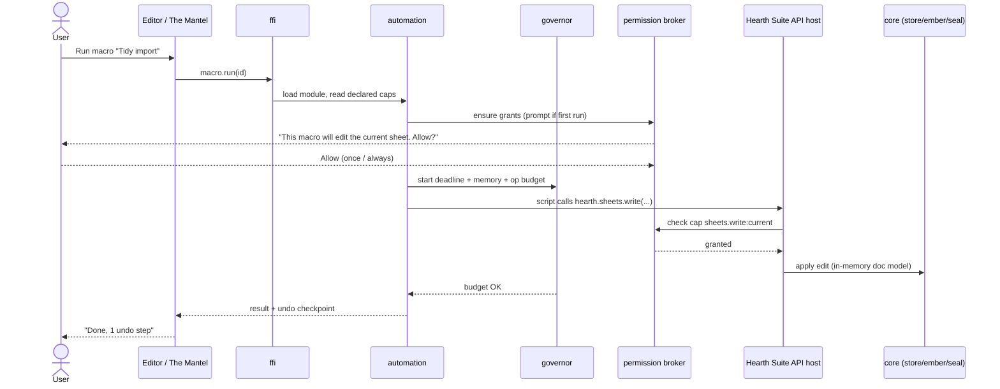

# Epic 1, Macros & Coding Capabilities

**Phase:** 5 · **Build prompts:** P5.1–P5.6 · **Acceptance:** `AC-MAC-*`
**Depends on:** v1 core (`bundle`, `store`, `ember-bridge`, `seal`, `ffi`), the four editors.
**Enables:** The Forge (epic 2, visual authoring of these scripts), Kindling (epic 3, the packaged form of this code), Marketplace (epic 5, sale of macros).

---

## 1. Summary & goals

Give Hearth Suite users automation and programmability, from a one‑click recorded macro to a full typed script, **without ever breaking the offline, privacy, and "calm by default" promises.** A spreadsheet user should be able to record "clean up this import" and replay it; a power user should be able to write a script that reads Records, drafts a letter in Writer via Ember, and Seals the result, all on‑device, all sandboxed.

**Goals**
1. A **macro recorder** in every editor that turns user actions into an editable, replayable script.
2. A **scripting language and runtime** that is sandboxed, deterministic, resource‑limited, and identical to the one Kindling use (one engine, one API).
3. A **typed Hearth Automation API** spanning Writer, Sheets, Records, Calendar, Ember, Seal, Bundle and a minimal UI surface.
4. **Triggers** (manual, hotkey, on‑event, local schedule) so macros run when useful.
5. **Progressive depth:** recorded → blocks (epic 2) → code, round‑tripping at every layer.

**Non‑goals (v1 of this epic)**
- No cloud execution; macros run locally only.
- No ambient network; `net.*` is a per‑host, user‑granted capability, off by default.
- No background daemon that runs without the app open (local schedule fires only while Hearth Suite runs, or via the OS‑level signed task the desktop client already owns), `[IMPL CHOICE]`.

---

## 2. Design rationale (why these choices)

- **One language for macros and extensions.** Authors should learn one thing. The UI is TypeScript; the Extension SDK (epic 3) is TypeScript; therefore macros are authored in **TypeScript** and executed as JavaScript. This collapses three would‑be ecosystems (macro language, extension language, marketplace‑code language) into one.
- **Engine = QuickJS via `rquickjs`** `[IMPL CHOICE: Boa or a V8 isolate are alternates]`. Rationale: tiny, fast cold‑start (macros must feel instant), embeddable in the Rust core, no JIT surface to harden, easy to wrap with hard resource limits, and it runs with **no host bindings except those we inject**, the perfect deny‑by‑default substrate. A heavier engine (V8) is only justified if a future feature needs its performance; the API is engine‑agnostic so the swap stays local.
- **Capability security over trust.** Rather than "trusted vs untrusted macros", *all* macros run with zero authority and request capabilities. A recorded macro that only edited the current sheet is granted exactly `sheets.write:current`. This makes a shared macro safe to run and is the same model Kindling and Marketplace items use (see [README §3.2](README.md#32-one-capability--permission-model)).
- **Determinism & reproducibility.** No wall‑clock or RNG by default (injected, seedable shims instead), so a macro replays identically and a property test can assert it. Ember calls are the one intentionally non‑deterministic capability and are labelled as such.

---

## 3. Architecture

### 3.1 Crates & surfaces
- **`crates/automation`** (new): the engine host. Sub‑modules: `engine` (rquickjs sandbox + module loader), `governor` (CPU‑time deadline, memory cap, op‑count budget, stack depth), `broker` (capability grants, prompts, scoping), `api` (the Hearth Automation API host functions), `triggers` (event + hotkey + local schedule registry).
- **`crates/macro-record`** (new): editor action capture → normalised action log → script codegen. Lives partly in TS (capture in the UI) and partly in Rust (codegen + storage).
- **`ffi` additions:** `macro.list/save/run/cancel`, `macro.record.start/stop`, `automation.grant/revoke`, `triggers.register/unregister`. Generated into the TS client.
- **Storage:** macros persist either **in a Bundle** (travels with the project) or in a per‑user **Macro Library** in the store. A macro is a small record: id, name, source (TS), compiled module hash, declared capabilities, trigger bindings, author signature (optional).

### 3.2 The Hearth Automation API (surface sketch)
Capability‑gated, promise‑based, typed. Illustrative, full `.d.ts` ships with the SDK (epic 3, P7.5).

```typescript
// Every namespace call is brokered; calling one not granted throws PermissionDenied.
hearth.bundle      // open/list documents, metadata, create/save (cap: bundle.read|write)
hearth.writer      // blocks, selection, styles, insert, replace, export (cap: writer.read|write)
hearth.sheets      // ranges, cells, formulas, recalc, charts (cap: sheets.read|write)
hearth.records     // tables, query, rows CRUD, relations (cap: records.read|write:<table>)
hearth.calendar    // events, contacts, reminders (cap: calendar.read|write)
hearth.ember       // run(task, context, effort) -> stream  (cap: ember.run), on‑device only
hearth.seal        // sign, seal(recipients), unseal, hallmark (caps: seal.sign|seal.seal|seal.hallmark)
hearth.ui          // prompt, pick, toast, progress, form (cap: ui, non‑sensitive, always available)
hearth.net         // fetch(url), cap: net.fetch:<host>, DENIED by default
hearth.util        // clock(), random(seed), deterministic shims unless cap time/random granted
```

### 3.3 Execution sequence



### 3.4 Triggers
A macro may bind to: **manual** (run button / command palette), **hotkey**, **on‑event** (`document.opened`, `record.row.added`, `bundle.sealed`, etc., events the core already emits), or a **local schedule** (cron‑like, fires only while the client runs unless the OS task is enabled, `[IMPL CHOICE]`). Event/schedule macros must still pass the permission broker; a triggered macro that needs `net.*` is refused unless previously granted "always".

### 3.5 Undo, safety & cancellation
- Every macro run is wrapped in a single **undo checkpoint** per affected document, so any run is one Ctrl‑Z away.
- The governor enforces a wall‑clock **deadline**, a **memory cap**, and an **operation budget**; exceeding any aborts cleanly with a clear message and full rollback.
- A visible **Cancel** is always available for long runs; cancellation is cooperative at API boundaries and hard at the deadline.

### 3.6 Data‑model delta
Add to the store (extends ER model 05_er):
- `MACRO { uuid id PK, uuid bundle_id FK NULL, string name, text source, blob compiled_hash, json declared_caps, json triggers, blob author_sig NULL, timestamp updated_at }`
- `MACRO_GRANT { uuid id PK, uuid macro_id FK, string capability, string scope, string mode "once|always", timestamp granted_at }`
- `MACRO_RUN { uuid id PK, uuid macro_id FK, timestamp ran_at, string outcome, int ops, int ms }` (local run log; content‑free; AC‑DATA‑1 still holds).

---

## 4. Security & privacy model

1. **Deny‑by‑default.** A fresh macro can do nothing but call `hearth.ui.*` and deterministic `hearth.util.*`. Everything else is a brokered capability.
2. **No ambient network.** `hearth.net.fetch` requires `net.fetch:<host>`; granting is per‑host, shown in plain language, and never implied by any other capability. The Ember zero‑egress guarantee (AC‑AI‑1) is preserved: `hearth.ember.run` is on‑device and emits nothing.
3. **No filesystem.** Scripts never see a path. All persistence is through `hearth.bundle`/`hearth.records`, themselves scoped.
4. **Resource‑bounded.** Deadline + memory + op budget make a hostile or buggy macro a contained failure, not a hang.
5. **Provenance for shared macros.** A macro imported from a file or the Marketplace carries the author's ML‑DSA signature; the client verifies it and shows the author before first run. Unsigned imported macros are clearly flagged "unsigned, author unknown".
6. **Consent is legible.** The broker prompt names concrete effects ("edit the current sheet", "read the Invoices table", "reach api.exchangerates.example"), never raw capability strings only.

---

## 5. Build prompts

### P5.1, Sandboxed automation engine
```
Implement the `automation` crate's `engine` and `governor`. Embed a JavaScript engine (rquickjs/QuickJS [IMPL CHOICE]) with NO host bindings by default. Add a module loader that accepts a single compiled JS module (the macro) and nothing else (no fs/network/require). Implement the governor: a wall‑clock deadline, a memory ceiling, an operation/instruction budget, and a max stack depth, exceeding any aborts the run cleanly with a typed error and leaves no partial host state. Provide a deterministic context by default: injected seedable clock and RNG shims; no access to the real clock/RNG unless a capability is granted later. Expose `run(module, ctx) -> RunResult` and cooperative `cancel()`. Property‑test that the same module + same seed produces identical output, and that a runaway loop is killed within the deadline with full rollback.
Satisfies: AC-MAC-1, AC-MAC-2.
```

### P5.2, Capability/permission broker
```
Implement the `automation` crate's `broker`. Define a capability grammar (`<namespace>.<verb>[:<scope>]`, e.g. `sheets.write:current`, `records.read:Invoices`, `ember.run`, `seal.sign`, `net.fetch:https://host`). Implement: declared‑capability parsing from a macro header / manifest; a grant store (once vs always, per scope) persisted as MACRO_GRANT; and a brokered check at every API call. Render plain‑language consent text from a capability (table of human strings), never raw strings alone. `net.*` and `util.time`/`util.random` are denied unless explicitly granted. Provide `grant`, `revoke`, `list`, and `check`. Add tests: a macro with no grant cannot reach any sensitive API; a scoped grant does not widen to other scopes; revoking takes effect immediately.
Satisfies: AC-MAC-3, AC-MAC-7.
```

### P5.3, Hearth Automation API host
```
Implement the `automation` crate's `api`: the brokered host functions backing the `hearth.*` namespaces (bundle, writer, sheets, records, calendar, ember, seal, ui, net, util) against the in‑memory document model and core crates. Every sensitive call first asks the broker. `hearth.ember.run` routes to ember-bridge and remains on‑device (assert zero egress). `hearth.seal.sign/seal/hallmark` route to seal/key-manager and require explicit caps. `hearth.ui.*` (prompt/pick/toast/progress/form) is non‑sensitive. Wrap each run in one undo checkpoint per affected document with rollback on error/cancel. Generate the TypeScript `.d.ts` for the whole surface. Add integration tests exercising a read→transform→write→seal flow under least‑privilege grants.
Satisfies: AC-MAC-4, AC-MAC-8.
```

### P5.4, FFI surface & macro storage
```
Extend the `ffi` crate with: macro.list/get/save/delete/run/cancel, macro.record.start/stop, automation.grant/revoke/list, triggers.register/unregister. Add MACRO, MACRO_GRANT, MACRO_RUN to the store with migrations; macros may live in a Bundle (travels with it) or the per‑user Macro Library. Persist source, compiled‑module hash, declared caps, triggers, and optional author signature. Regenerate the typed TS client. Add binding integration tests covering save→run→undo and a Bundle‑scoped macro round‑tripping with the Bundle.
Satisfies: AC-MAC-9, extends AC-FFI-1.
```

### P5.5, Macro recorder
```
Implement `macro-record`: capture user actions in Writer/Sheets/Records/Calendar as a normalised, semantic action log (not raw input, e.g. "set range B2:B10 = trim(B2:B10)", not mouse coordinates), then generate readable, editable TypeScript using the Hearth Automation API. The recorder infers the minimal capability set from the captured actions and writes it into the macro header. Provide start/stop/pause UI in each editor and a "review & save" step that shows the generated script and the inferred permissions. Add tests asserting that recording a known action sequence yields a script which, when replayed on the same input, reproduces the result.
Satisfies: AC-MAC-5, AC-MAC-6.
```

### P5.6, Triggers & command surface
```
Implement the `automation` triggers registry and wire it to The Mantel command palette and each editor. Support manual run, user‑assigned hotkeys, on‑event bindings (document.opened, record.row.added, bundle.sealed, …), and a local cron‑style schedule that fires only while the client runs (an OS‑level signed background task is [IMPL CHOICE], off by default). Every triggered run still passes the broker; a triggered macro needing an ungranted capability is skipped with a surfaced notice rather than prompting in the background. Show a "Macros" manager listing bindings, last‑run outcomes (from MACRO_RUN), and per‑macro enable/disable. Add tests for event firing, hotkey dispatch, and refusal of an under‑permissioned triggered run.
Satisfies: AC-MAC-10.
```

---

## 6. Acceptance criteria

**AC-MAC-1, Sandboxed by construction**
```
Given a macro that attempts to read a file, open a socket, or require a module
When it runs
Then every such attempt fails because no host binding exists for it
And the macro can only affect Hearth Suite through the granted Hearth Automation API.
```

**AC-MAC-2, Resource‑bounded execution**
```
Given a macro with an infinite loop or excessive memory use
When it runs under the governor
Then it is aborted within the configured deadline / memory ceiling
And all document state is rolled back to before the run, with a clear error.
```

**AC-MAC-3, Deny‑by‑default capabilities**
```
Given a newly created macro with no granted capabilities
When it calls any sensitive namespace (writer/sheets/records/calendar/ember/seal/net)
Then the call is denied until the user grants the specific, scoped capability.
```

**AC-MAC-4, Typed API across modules**
```
Given the Hearth Automation API
When a macro reads Records, drafts text via Ember, writes it into Writer, and Seals the Bundle
Then each step works through the typed API under least‑privilege grants, fully on‑device.
```

**AC-MAC-5, Recorder produces editable scripts**
```
Given a user records a sequence of edits in an editor
When recording stops
Then a readable TypeScript macro is generated that reproduces the edits on the same input
And the inferred minimal capability set is shown before saving.
```

**AC-MAC-6, Replay fidelity**
```
Given a recorded macro and identical starting input
When the macro is replayed
Then the resulting document state is identical to the original recorded run.
```

**AC-MAC-7, Network is opt‑in per host**
```
Given a macro that calls hearth.net.fetch
When it runs without a net.fetch:<host> grant
Then the call is denied; and when granted for one host, it cannot reach a different host.
```

**AC-MAC-8, Undo & cancel**
```
Given any macro run that modifies documents
When the user presses undo, or cancels mid‑run
Then the changes are reverted as a single undo step / the run stops and rolls back cleanly.
```

**AC-MAC-9, Portability with the Bundle**
```
Given a macro saved inside a Bundle
When the Bundle is copied to another device and opened
Then the macro is present and runs (subject to fresh permission consent on that device).
```

**AC-MAC-10, Triggers fire safely**
```
Given a macro bound to an event/hotkey/local schedule
When the trigger fires
Then the macro runs through the permission broker; an under‑permissioned triggered run is skipped with a surfaced notice rather than silently gaining authority.
```

**AC-MAC-11, On‑device guarantee preserved**
```
Given any macro that uses hearth.ember.*
When it runs
Then a network monitor confirms zero outbound content (consistent with AC-AI-1).
```

**AC-MAC-12, Provenance for shared macros**
```
Given a macro imported from a file or the Marketplace
When it is opened
Then its author signature is verified and the author (or "unsigned, author unknown") is shown before the first run is permitted.
```

---

## 7. Open `[IMPL CHOICE]` points
- Engine: rquickjs vs Boa vs V8 isolate (default rquickjs).
- Whether local schedules may run via a signed OS background task when the app is closed (default: no).
- Maximum default budgets (deadline/memory/ops) and how users raise them for trusted long jobs.
- Whether the Macro Library is itself a special Bundle (so it can be Sealed and synced), recommended.
