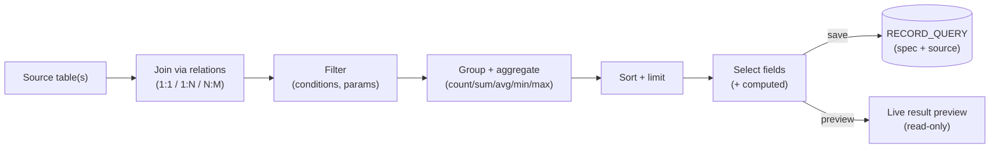
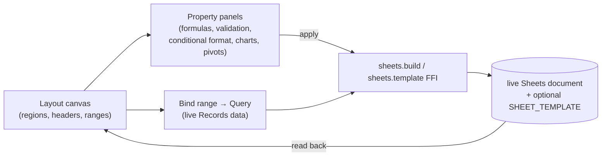
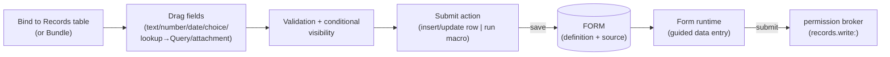
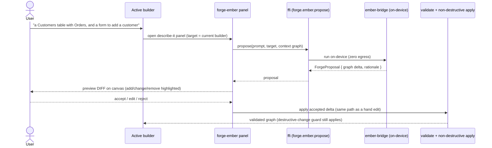

# Epic 2, The Forge: Visual Drag‑and‑Drop Builders

**Phase:** 5 · **Build prompts:** P6.1–P6.11 · **Acceptance:** `AC-FORGE-*`
**Depends on:** Records (v1 P2.5, no‑code relations), the automation runtime (epic 1, the sandbox/AST every visual builder compiles to), `ember-bridge` (on‑device Ember, for describe‑it‑and‑build authoring), `bundle`/`store`/`ffi`.
**Enables:** Non‑coders to build databases, queries, functions, sheets, forms, organise Bundles, and author macros/Kindling logic without writing text, then drop to code on any of them.

---

## 1. Summary & goals

**The Forge** is Hearth Suite's unified visual construction surface, a calm canvas where you *build by dragging or by describing*, not by typing. It honours progressive depth: the visual layer always sits **above** a real artifact (a Records schema, a saved Query, a derived‑field Function, a Sheets layout, a Form definition, a Bundle layout, or a Hearth Script) and round‑trips with it, so a beginner stays in blocks while an expert drops to code, and neither loses the other's work.

It is a **family of builders sharing one canvas framework, one artifact bridge, and one Ember‑assist panel**:

1. **Database & Relationship Builder**, drag tables onto a canvas, add fields, draw relationships (1:1, 1:N, N:M); generates/edits the live Records schema.
2. **Query Builder**, visually compose filters, sorts, joins across relations, grouping and aggregation into a named, parameterizable **Query** (a saved view); read‑only by default.
3. **Function & Logic Builder**, build **computed/derived fields, validation rules, and row‑level triggers** for a Records database as visual logic that compiles to the same sandboxed Hearth Script as macros.
4. **Sheets Builder**, lay out a spreadsheet visually: regions, headers, named ranges, formulas, data validation, conditional formatting, charts and pivots, materialising a real Sheets document, optionally with ranges bound live to a Query.
5. **Forms Builder**, build a **Form** bound to a Records table (or Bundle): fields, layout, validation, conditional visibility, and a submit action (insert/update a row, or run a macro), for fast, guided data entry.
6. **Bundle Organiser**, drag‑and‑drop arrangement of a Bundle's documents, data sources, assets, and macros into groups and a clear structure.
7. **Visual Macro / Script Builder**, a block (Scratch/Blockly‑style) *and* node‑graph editor that compiles to the exact Hearth Script from epic 1, and decompiles back from it.

Two capabilities cut across **every** builder above:

- **Ember‑assisted authoring ("describe it").** In any builder you can tell Ember, in plain language, what you want, *"a Customers table with Orders, and a form to add a customer with a required email"*, and Ember (on‑device) proposes the corresponding graph/artifact as a **reviewable preview diff** on the canvas. Nothing is applied until you accept; you can edit the proposal by hand before or after.
- **Drop to code, on anything.** Every artifact a builder produces has a "show me the code" view that round‑trips losslessly with the visual graph and honours an honest code‑edit boundary, not just macros.

**Goals**
- Make the most intimidating tasks (schema design, queries, automation, forms) approachable for Works‑grade users, by dragging *or* by describing.
- Guarantee **two‑way** sync for every builder: visual ⇄ artifact ⇄ code, never a lossy one‑way generator.
- Make Ember a **proposer, never an applier**: AI output is always a reviewable diff through the same validation/apply path as a manual edit.
- Keep everything **local and offline**; The Forge edits in‑memory models through the FFI and runs Ember on‑device, nothing leaves the device.

---

## 2. Design rationale

- **One canvas, many builders.** A single, well‑tested canvas framework (pan/zoom, drag, snap, connect, select, undo, keyboard‑accessible) is built once and parameterised by node/edge types. This avoids seven half‑built editors and gives a consistent feel across schema, query, function, sheet, form, Bundle and macro work.
- **Visual is a view, not a format.** The source of truth is always the underlying artifact, the Records schema, a saved Query, a Function's script, the Sheets model, a Form definition, the Bundle manifest, or the TS macro. The Forge reads it into a graph, lets the user edit the graph, and writes changes back. This is what makes round‑tripping honest (AC‑FORGE‑2/5/18/19) and lets advanced users hand‑edit the artifact and reopen The Forge without surprises.
- **One artifact bridge for all "drop to code."** Rather than special‑casing macros, every builder is backed by a canonical textual artifact and a single bridge contract, `toGraph` / `fromGraph` / `format` with **trivia preservation** and an explicit *un‑representable region* marker. Schema, query, function, sheet, form and macro all implement the same contract, so "show me the code → edit → back to blocks" behaves identically everywhere.
- **Blocks for control flow, nodes for data flow.** The macro and function builders offer **blocks** (sequential, imperative, "do this, then that") and a **node graph** (data‑flow, "this table → filter → Ember → Writer"). The query builder is naturally a data‑flow graph; the form/sheet builders are layout canvases with property panels. All logic‑bearing builders target the same Hearth Script AST; `[IMPL CHOICE]` whether to ship blocks first.
- **Queries are read‑only by default; functions and forms are least‑privilege.** A Query needs only `records.read:<table>` and can never write. A Function (computed field/validation) runs deterministically with no ambient authority; a trigger or a Form's submit handler requests exactly the scoped write capability it needs (e.g. `records.write:Customers`) through the same broker as a macro.
- **Ember proposes, the user disposes.** Ember‑assisted authoring emits a *proposal* (a builder graph + a diff), never a direct mutation. The proposal flows through the **same** validation and non‑destructive apply path as any hand edit, including the destructive‑change guard, so AI can never silently drop data or widen permissions. Ember runs on‑device via `ember-bridge`; zero egress (AC‑AI‑1) holds.
- **Reuse, don't reinvent.** A mature open block library (e.g. Blockly) and a node‑graph lib `[IMPL CHOICE]` may back the editors, but they emit/consume Hearth Suite artifacts (AST, query spec, form/sheet definition) so we are never locked to a vendor format.
- **Accessibility is non‑negotiable.** Drag‑and‑drop, *and the Ember‑assist flow*, must have full keyboard and screen‑reader equivalents (WCAG 2.1 AA, AC‑A11Y‑1), every drag has a menu/keyboard alternative, and every Ember proposal is reviewable and acceptable from the keyboard.

---

## 3. Architecture

### 3.1 Surfaces
- **UI:** a shared `packages/forge-canvas` (framework‑agnostic canvas + interaction model), a shared `packages/forge-ember` (the describe‑it proposal panel + diff review, reused by every builder), and a Forge surface in the shell (`apps/shell`) hosting the builders. The Forge can open standalone or docked beside an editor (e.g. schema builder next to a Records table, form builder next to its target table).
- **Core/FFI:** The Forge does **not** get a new persistence format. It uses existing FFI plus thin additions:
  - Database builder → Records schema FFI (`records.schema.get/apply`, relations), extended for diff‑based apply and validation.
  - Query builder → `records.query.*` (save/run/preview a named Query) + the artifact bridge `records.query.toGraph/fromGraph`.
  - Function builder → `records.function.*` (computed fields, validations, triggers) compiling through the **automation** crate, reusing `script.toGraph/fromGraph`.
  - Sheets builder → `sheets.build.apply` / `sheets.template.*` and the live Sheets model FFI; `sheets.toGraph/fromGraph`.
  - Forms builder → `forms.*` (save/render/submit) + `forms.toGraph/fromGraph`.
  - Bundle organiser → `bundle.layout.get/apply` (a manifest section for groups/order; content unchanged).
  - Macro builder → `automation` compile/decompile FFI: `script.toGraph(source) -> Graph` and `script.fromGraph(graph) -> source`.
  - Ember‑assist → `forge.ember.propose(prompt, target, context) -> ForgeProposal` (on‑device; returns a builder graph + diff, applies nothing).
- **Artifact bridge:** every builder's correctness rests on a stable artifact + a single bridge contract (`toGraph`/`fromGraph`/`format`, trivia‑preserving, with an un‑representable‑region marker). For logic this is the **Hearth Script AST** in the `automation` crate; for queries/forms/sheets it is a declarative spec with the same contract. Dropping to code and back is non‑destructive everywhere (§3.10).

### 3.2 Database & relationship builder

```mermaid
flowchart LR
    canvas["Forge canvas"] -->|edits| graph["Schema graph\n(tables, fields, relations)"]
    graph -->|diff + validate| ffi["records.schema FFI"]
    ffi --> store[("store: RECORD_TABLE / FIELD / RELATION")]
    store -->|read back| graph
```
- Drag a **table** node; add **fields** with types (text, number, date, choice, attachment, lookup, formula …); draw an **edge** to create a relationship and pick cardinality (1:1, 1:N, N:M, N:M offers to create the join table automatically).
- Live **validation**: name collisions, orphan relations, type mismatches on lookups, and *data‑safety* warnings ("removing this field deletes data in 240 rows, preview / confirm").
- **Non‑destructive apply:** changes are a reviewed migration diff, never a silent drop; reversible where possible.
- Reads an existing Records database back into the canvas so The Forge edits, not just creates.
- Opens the **Query**, **Function**, and **Form** builders in context for any table on the canvas (build the schema, then a view, a computed field, and an entry form without leaving the surface).

### 3.3 Query builder


- A data‑flow graph: pick a source table, follow existing relationships to **join** related tables, add **filter** conditions (with named **parameters** so a Query is reusable, e.g. `:since`), **group + aggregate**, **sort + limit**, and **select** the output fields (including computed expressions reused from the Function builder).
- **Read‑only by construction.** A Query compiles to `hearth.records.query` and needs only `records.read:<table>` for each table it touches; it has no write node and can never mutate data. This is what makes a saved Query safe to share and embed (in a Sheet binding or a Form's choice list).
- **Live preview** of the result set against current data, with row counts and obvious "this is filtered/sampled" affordances (no silent truncation).
- Saved as a named **Query** that other builders consume (Sheets ranges, Form lookups, macro inputs) and that round‑trips to a readable query source via the artifact bridge.

### 3.4 Function & logic builder
- Builds the three kinds of database logic Records supports, all on the macro builder's block/node engine and the same AST bridge:
  - **Computed / derived field**, a pure expression over the row (and looked‑up/related values) producing a field value; deterministic, no side effects, no capabilities.
  - **Validation rule**, a predicate that accepts/rejects a row write with a human message ("Email must contain @"); pure, no capabilities.
  - **Row‑level trigger**, logic that runs on `record.row.added/updated/deleted` (the events epic 1 already emits), which *may* request scoped capabilities (e.g. `records.write:AuditLog`) through the broker, exactly like a macro.
- Computed fields and validations are **sandboxed and pure by default**, the governor's deadline/memory/op budget applies, and they get no ambient authority. Triggers are full sandboxed scripts with declared, consented capabilities (AC‑MAC‑3).
- "Drop to code" shows the field expression / rule / trigger as Hearth Script; edits round‑trip like any macro and honour the code‑edit boundary (§3.10).

### 3.5 Sheets builder


- A layout canvas for spreadsheets: place **regions** (title, header row, data body, totals), define **named ranges**, attach **formulas**, **data validation**, and **conditional formatting**, and drop in **charts** and **pivot** definitions, all via property panels with keyboard equivalents.
- **Bind a range to a Query** so the sheet shows live Records data that refreshes (read‑only binding via `records.read`); unbound ranges are ordinary editable cells.
- Materialises a **real Sheets document** through the existing Sheets model (so every v1 Sheets feature still applies) and, optionally, a reusable **SHEET_TEMPLATE** for "new sheet from template".
- Reads an existing sheet back into the builder for layout‑level editing; "drop to code" exposes the sheet/template definition source via the artifact bridge.

### 3.6 Forms builder


- Bind a form to a **Records table** (the common case) or a Bundle; drag in **fields** whose types map to the table's columns, including **lookup fields backed by a Query** (a dropdown populated from a saved view) and attachments.
- Add **validation rules** (reusing the Function builder's predicate logic) and **conditional visibility** (show field B only when A = x).
- Choose a **submit action**: insert a new row, update an existing one, or run a macro, each requesting exactly the scoped capability it needs (`records.write:<table>`, or the macro's own caps) through the broker. A form that only reads (e.g. a survey writing to one table) is least‑privilege by construction.
- Saved as a **Form** artifact rendered by a small form runtime in the shell; "drop to code" exposes the form definition + submit‑handler script via the artifact bridge.

### 3.7 Bundle organiser
- A spatial/tree hybrid: drag documents, linked data sources, assets, and macros into **groups**, reorder, rename, and set the Bundle's "open to" entry. Purely organisational metadata in the manifest, **no content is moved or re‑encrypted**, and a Sealed Bundle stays Sealed (organising never requires unsealing content keys, only manifest edits the owner is authorised to make).
- Surfaces what's inside a Bundle at a glance (the "what's in this project?" view Works never had), including Seal status and Hallmark status (epic 4) per document, and now also the queries, forms and sheet templates the Bundle defines.

### 3.8 Visual macro / script builder

```mermaid
flowchart LR
    subgraph forge["Macro builder"]
        blocks["Block editor"]
        nodes["Node‑graph editor"]
    end
    ast["Hearth Script AST\n(automation crate)"]
    code["TypeScript source"]
    blocks <-->|toGraph / fromGraph| ast
    nodes  <-->|toGraph / fromGraph| ast
    ast    <-->|parse / print (trivia‑preserving)| code
    code --> run["Sandboxed run (epic 1)"]
```
- Palette mirrors the Hearth Automation API: blocks/nodes for Records query, Sheets range ops, Writer insert, Ember run, Seal/Hallmark, UI prompts, control flow, variables.
- **Capabilities surface visually:** any block requiring a capability shows a badge; the builder aggregates the required permissions and writes them into the macro header (same consent model as epic 1).
- **Live "show me the code"** toggle renders the equivalent TypeScript; edits there reflect back into blocks on return (where representable) and otherwise mark the macro "code‑edited beyond blocks" with a clear, non‑destructive boundary.
- **Test run** inside the builder uses the sandbox with a dry‑run/undo‑checkpoint so users can experiment safely.

### 3.9 Ember‑assisted authoring ("describe it")


- A shared panel (`packages/forge-ember`) available in every builder. The user describes intent in plain language; Ember (on‑device) returns a **`ForgeProposal`**: a builder‑graph delta plus a short rationale and any required capabilities, appropriate to the **active builder's target** (schema, query, function, sheet, form, or macro).
- The proposal is shown as a **diff preview on the canvas** (added/changed/removed nodes highlighted). The user can accept it whole, accept parts, edit it, or reject it, fully from the keyboard.
- **Ember never applies anything directly.** An accepted proposal flows through the *same* validation and non‑destructive apply path as a manual edit, including the destructive‑change guard with row counts and the capability broker. An unsafe or data‑losing proposal is surfaced for confirmation, never silently applied; a rejected proposal changes nothing.
- **On‑device, zero egress.** `forge.ember.propose` routes through `ember-bridge`; AC‑AI‑1 holds and is asserted (AC‑FORGE‑16).

### 3.10 The Forge artifact bridge (universal visual ⇄ code)
- One contract, implemented per artifact: `toGraph(source) -> Graph`, `fromGraph(graph) -> source`, `format(source) -> source`, each **trivia‑preserving** (comments/formatting survive) and each able to mark an **un‑representable region**, a part of the code the visual layer can't model, so it is **preserved and flagged**, never dropped.
- Implementations:
  - **Schema** ⇄ a schema DSL/DDL source.
  - **Query** ⇄ a query source (a readable query expression / SQL‑subset).
  - **Function / Macro** ⇄ Hearth Script (the `automation` AST, P6.4).
  - **Sheet** ⇄ a sheet/template definition source.
  - **Form** ⇄ a form definition + submit‑handler source.
- Because the contract is uniform, the same "show me the code", the same byte‑stable round‑trip property test, and the same honest code‑edit boundary apply to **every** builder (AC‑FORGE‑18/19), not just macros.

### 3.11 Data‑model delta
- `bundle` manifest gains an optional `layout` section: `groups[]`, `items[] {ref, group, order}`, `entry_ref`, manifest‑only, included in the signed manifest (so AC‑BND‑2 still covers it).
- `store` gains (if not already present from v1 relations):
  - `RECORD_RELATION { uuid id PK, uuid from_table FK, uuid to_table FK, string kind "1:1|1:N|N:M", uuid join_table FK NULL, json on }`.
  - `RECORD_QUERY { uuid id PK, uuid db_id FK, string name, json spec, text source, json params, timestamp updated_at }`, a saved, read‑only, parameterizable view.
  - `RECORD_FUNCTION { uuid id PK, uuid db_id FK, string kind "computed|validation|trigger", string name, text source, blob compiled_hash, json declared_caps, json bindings, timestamp updated_at }`, computed fields/validations are pure (empty `declared_caps`); triggers carry consented caps like a macro.
  - `FORM { uuid id PK, uuid bundle_id FK NULL, uuid db_id FK NULL, string name, json definition, text source, json submit, json declared_caps, timestamp updated_at }`.
  - `SHEET_TEMPLATE { uuid id PK, uuid bundle_id FK NULL, string name, json layout, text source, timestamp updated_at }` (the Sheets builder also edits live Sheets documents directly through the existing model).
- `RECORD_FIELD` is extended to reference a `RECORD_FUNCTION` for computed fields and validations. The Forge is a **client** of all of these, not a new owner; persistence, migrations and Sealing are unchanged.

---

## 4. Security, privacy & safety
- The Forge introduces **no new trust surface**: it edits the same artifacts through the same FFI with the same authorisation as manual editing. No network. No new secrets.
- **Ember is a proposer, not an actor.** Ember‑assisted authoring produces a reviewable diff that goes through the identical validation/apply path as a hand edit. Ember cannot bypass the destructive‑change guard, cannot widen capabilities, and cannot apply anything the user did not accept. Ember runs **on‑device** via `ember-bridge` with **zero egress** (AC‑AI‑1 preserved; AC‑FORGE‑16).
- **Destructive‑change guard:** schema edits (typed *or Ember‑proposed*) that would lose data require an explicit, previewed confirmation with row counts; default action is the safe one.
- **Queries are read‑only.** A saved Query needs only `records.read:<table>` and has no write path; it is safe to share and to embed in Sheets bindings and Form lookups.
- **Functions and forms are least‑privilege.** Computed fields and validation rules are pure and capability‑free. Triggers and Form submit handlers request exactly the scoped write capability they need (e.g. `records.write:Customers`) through the epic‑1 broker, with legible consent, a visually built logic unit is exactly as constrained as a hand‑written one.
- **Sealed Bundles:** organising never unseals content. Schema/query/function/sheet/form/macro building on a Sealed Bundle requires the same unseal the editors already require to view content (AC‑SEC‑4 unchanged).
- **Generated artifacts inherit the sandbox.** Any logic produced by The Forge, visually, or by accepting an Ember proposal, runs in the epic‑1 sandbox under explicit, consented capabilities (AC‑MAC‑1/3 still hold).
- **Honest code boundary:** dropping any artifact to code and editing beyond what the visual layer models never silently discards the edit; the un‑representable region is preserved and clearly marked on reopen (AC‑FORGE‑19).

---

## 5. Build prompts

### P6.1, Forge canvas framework
```
Build `packages/forge-canvas`: a framework‑agnostic, reusable canvas with pan/zoom, drag‑and‑drop of typed nodes, edge drawing/connection with validation hooks, multi‑select, snapping/alignment, and an undo/redo stack. CRITICAL: every drag/connect interaction has a full keyboard and screen‑reader equivalent (move/connect/delete via menu + keys; ARIA roles; focus management) to meet WCAG 2.1 AA. Parameterise node/edge rendering and validation so the same canvas backs all Forge builders (schema, query, function, sheet, form, Bundle, macro). Theme it with the Hearth Suite design tokens (light/dark). Provide a stories/harness page exercising nodes, edges, keyboard ops, and large‑graph performance.
Satisfies: AC-FORGE-1, AC-FORGE-7 (extends AC-A11Y-1).
```

### P6.2, Database & relationship builder
```
Build the visual Database & Relationship Builder on the Forge canvas, backed by the Records schema. Implement: drag tables; add/edit fields with all Records field types; draw relationships choosing cardinality (1:1, 1:N, N:M, auto‑create the join table for N:M); live validation (name collisions, bad lookups, orphan relations). Read an existing Records database into the canvas (edit, not just create). Apply changes as a reviewed, non‑destructive migration diff via the records.schema FFI; any data‑losing change requires explicit confirmation showing affected row counts. Provide in‑context launch points to the Query, Function and Form builders for any table on the canvas. Add tests: create a 3‑table schema with an N:M relation and verify it persists per the ER model and reopens identically in the canvas.
Satisfies: AC-FORGE-2, AC-FORGE-3.
```

### P6.3, Bundle organiser
```
Build the visual Bundle Organiser on the Forge canvas. Let users drag documents, linked data sources, assets, queries, forms, sheet templates and macros into groups, reorder them, rename, and set the Bundle's entry item, writing only to a new manifest `layout` section (content is never moved or re‑encrypted; a Sealed Bundle stays Sealed and the layout is part of the signed manifest). Show per‑item Seal and Hallmark status at a glance. Add tests: organising a Bundle changes only the manifest layout, the signature still verifies (AC-BND-2), and content/seal state is untouched.
Satisfies: AC-FORGE-4.
```

### P6.4, Forge artifact ⇄ code bridge (incl. Hearth Script AST)
```
In the `automation` crate, define a stable Hearth Script AST with trivia preservation (comments/formatting), and implement lossless transforms: parse (TS source → AST), print (AST → TS source, preserving trivia), toGraph (AST → builder graph), fromGraph (graph → AST). Generalise this into ONE artifact‑bridge contract, toGraph / fromGraph / format, trivia‑preserving, with an explicit "un‑representable region" marker, and expose it via FFI as script.toGraph / script.fromGraph / script.format (the logic implementation), to be reused by the query, sheet and form bridges (P6.6/P6.8/P6.9). Property‑test round‑trips: source → AST → source is byte‑stable for formatted input; graph → AST → graph is structurally identical; and a code edit outside the block‑representable subset is detected and flagged (preserved, never silently dropped).
Satisfies: AC-FORGE-5, AC-FORGE-6, AC-FORGE-18.
```

### P6.5, Visual macro/script builder
```
Build the Visual Macro/Script Builder on the Forge canvas using the AST/graph bridge. Provide a block editor (and/or node‑graph editor [IMPL CHOICE on shipping both]) whose palette mirrors the Hearth Automation API (Records, Sheets, Writer, Ember, Seal/Hallmark, UI, control flow, variables). Show capability badges on blocks and aggregate required permissions into the macro header (same consent model as epic 1). Provide a live "show me the code" toggle (two‑way where representable; clearly bounded when code‑edited beyond blocks) and an in‑builder test run via the sandbox with a dry‑run/undo checkpoint. Add tests: build a macro visually that queries Records → drafts via Ember → writes Writer → Seals, compile it, run it under least‑privilege grants, and confirm it matches the hand‑written equivalent.
Satisfies: AC-FORGE-8, AC-FORGE-9.
```

### P6.6, Visual query builder
```
Build the visual Query Builder on the Forge canvas, backed by Records. Implement a data‑flow graph: choose source table(s), join along existing relationships (1:1/1:N/N:M), add filter conditions with named parameters, group + aggregate (count/sum/avg/min/max), sort + limit, and select output fields (including computed expressions from the Function builder). The Query is READ‑ONLY by construction, it compiles to hearth.records.query, has no write node, and needs only records.read:<table> for each table touched. Provide a live result PREVIEW against current data with honest row counts and no silent truncation. Persist as a named, parameterizable RECORD_QUERY via records.query.save/get/run/preview, consumable by the Sheets and Forms builders. Implement records.query.toGraph/fromGraph on the artifact‑bridge contract (drop to a readable query source and back). Add tests: build a two‑table joined, filtered, aggregated query; verify the preview matches a hand‑written query; verify it reopens identically and round‑trips to source byte‑stably; assert it can never write.
Satisfies: AC-FORGE-11, AC-FORGE-12.
```

### P6.7, Visual function & logic builder
```
Build the Function & Logic Builder on the Forge canvas, reusing the macro builder's block/node engine and the AST bridge. Support three kinds of Records logic: (1) computed/derived fields, pure expressions over the row and related/looked‑up values, no side effects, no capabilities; (2) validation rules, pure predicates that accept/reject a row write with a human message; (3) row‑level triggers on record.row.added/updated/deleted that MAY request scoped capabilities (e.g. records.write:AuditLog) through the broker like a macro. Computed fields and validations run pure under the governor (deadline/memory/op budget) with zero authority; triggers carry declared, consented caps. Persist as RECORD_FUNCTION and link computed/validation functions from RECORD_FIELD. Provide "show me the code" round‑tripping via script.toGraph/fromGraph. Add tests: a computed field recomputes deterministically; a validation rejects a bad row with its message; a trigger fires on row add and writes to another table only under a granted records.write scope; all three reopen identically and round‑trip to source.
Satisfies: AC-FORGE-13.
```

### P6.8, Sheets builder
```
Build the Sheets Builder on the Forge canvas, backed by the existing Sheets model. Provide a layout canvas: place regions (title/header/body/totals), define named ranges, attach formulas, data validation, conditional formatting, charts and pivot definitions, all with keyboard equivalents. Allow binding a range to a saved Query (live, read‑only Records data via records.read) while leaving unbound ranges editable. Materialise a real Sheets document via sheets.build.apply (so all v1 Sheets features still apply) and optionally a reusable SHEET_TEMPLATE via sheets.template.*. Read an existing sheet back into the builder for layout editing. Implement sheets.toGraph/fromGraph on the artifact‑bridge contract for "show me the code". Add tests: build a sheet with a header region, a bound Query range, a formula column, a conditional format and a chart; verify it persists and reopens identically, the bound range refreshes from Records, and the template round‑trips to source.
Satisfies: AC-FORGE-14.
```

### P6.9, Forms builder
```
Build the Forms Builder on the Forge canvas. Bind a form to a Records table (or a Bundle); drag in fields whose types map to the table's columns, including lookup fields backed by a saved Query (dropdown populated from a view) and attachments. Add validation rules (reusing the Function builder's predicate logic) and conditional visibility (show field B only when A = x). Choose a submit action, insert a new row, update an existing row, or run a macro, requesting exactly the scoped capability needed (records.write:<table>, or the macro's caps) through the broker. Persist as a FORM artifact rendered by a small form runtime in the shell; implement forms.save/get/render/submit and forms.toGraph/fromGraph for "show me the code". Add tests: build a form bound to a table with a required‑email validation and a Query‑backed dropdown; submitting a valid entry inserts a row only under a granted records.write:<table> scope; an invalid entry is rejected with its message; the form reopens identically and round‑trips to source.
Satisfies: AC-FORGE-15.
```

### P6.10, Ember‑assisted authoring ("describe it")
```
Build `packages/forge-ember`: a shared describe‑it panel available in every Forge builder. The user types intent in plain language; expose forge.ember.propose(prompt, target, context) which runs ON‑DEVICE via ember-bridge (zero egress) and returns a ForgeProposal, a builder‑graph DELTA, a short rationale, and any required capabilities, appropriate to the active builder's target (schema, query, function, sheet, form, or macro). Render the proposal as a DIFF preview on the canvas (added/changed/removed highlighted); let the user accept whole, accept parts, edit, or reject, fully from the keyboard. CRITICAL: Ember applies NOTHING directly. An accepted delta flows through the SAME validation and non‑destructive apply path as a hand edit, including the destructive‑change guard (row counts) and the capability broker; an unsafe/data‑losing proposal is surfaced for confirmation, a rejected proposal changes nothing. Add tests: a natural‑language prompt yields a schema/query/form proposal shown as a reviewable diff; accepting applies exactly the previewed delta; rejecting changes nothing; a data‑losing proposal triggers the destructive‑change guard; a network monitor confirms zero egress during propose.
Satisfies: AC-FORGE-16, AC-FORGE-17.
```

### P6.11, Universal drop‑to‑code & honest boundary across builders
```
Wire the artifact‑bridge contract (P6.4) through every builder so "show me the code" is uniform: schema ⇄ schema DSL/DDL, query ⇄ query source, function/macro ⇄ Hearth Script, sheet ⇄ sheet/template definition, form ⇄ form definition + submit handler. For each, implement format + byte‑stable round‑trip and the un‑representable‑region marker so a code edit beyond what the visual layer models is preserved and clearly flagged on reopen (never silently dropped). Add a consistent code panel with the same affordances in all builders. Add tests, per artifact type: graph → code → graph is structurally identical; formatted code → graph → code is byte‑stable; a hand edit outside the representable subset reopens in the correct builder with the un‑representable part preserved and marked.
Satisfies: AC-FORGE-18, AC-FORGE-19.
```

---

## 6. Acceptance criteria

**AC-FORGE-1, Accessible canvas**
```
Given the Forge canvas
When a user operates it with keyboard and a screen reader only
Then they can add, move, connect, and delete nodes, with no action available solely via mouse drag (WCAG 2.1 AA).
```

**AC-FORGE-2, Build a relational schema visually**
```
Given the Database Builder
When a user drags tables, adds fields, and draws 1:1 / 1:N / N:M relationships
Then a valid Records schema persists per the ER model and survives restart (N:M creates a join table automatically).
```

**AC-FORGE-3, Non‑destructive schema edits**
```
Given an existing Records database opened in the builder
When a user makes a change that would delete data
Then the change is presented as a previewed migration with affected row counts and requires explicit confirmation; safe changes apply without data loss.
```

**AC-FORGE-4, Organise without touching content**
```
Given a (possibly Sealed) Bundle in the Organiser
When the user regroups/reorders items
Then only the manifest layout changes, content is neither moved nor re‑encrypted, the Sealed state is preserved, and the manifest signature still verifies.
```

**AC-FORGE-5, Lossless visual⇄code round‑trip**
```
Given a macro authored in blocks
When the user toggles to code and back without editing
Then the blocks are unchanged; and a formatted script imported as blocks and exported is byte‑stable.
```

**AC-FORGE-6, Honest code‑edit boundary**
```
Given a macro edited in code beyond what blocks can represent
When reopened in the builder
Then the un‑representable portion is preserved and clearly marked, never silently dropped.
```

**AC-FORGE-7, Consistent themed canvas**
```
Given the Forge builders
When rendered in light and dark themes
Then they share one canvas with Hearth Suite design tokens and consistent interaction.
```

**AC-FORGE-8, Visual macro compiles & runs**
```
Given a macro built visually
When compiled and run
Then it executes in the epic‑1 sandbox under the capabilities aggregated from its blocks, producing the same result as the equivalent hand‑written macro.
```

**AC-FORGE-9, Permissions surfaced visually**
```
Given a visual macro using sensitive blocks
When viewed
Then each such block shows a capability badge and the aggregate required permissions are written into the macro header and shown before first run.
```

**AC-FORGE-10, Fully offline**
```
Given any Forge builder in use (including Ember‑assisted authoring)
When monitored
Then no network egress occurs; all edits go through the local FFI to in‑memory models and the store, and Ember runs on‑device.
```

**AC-FORGE-11, Build a query visually**
```
Given the Query Builder
When a user joins related tables, adds filters/parameters, groups and aggregates, sorts, and selects fields
Then a named Query persists, its live preview matches the equivalent hand‑written query, and it reopens identically after restart.
```

**AC-FORGE-12, Queries are read‑only & least‑privilege**
```
Given any Query built in the Forge
When it is compiled and run
Then it requires only records.read:<table> for the tables it touches, has no write path, and cannot mutate any data.
```

**AC-FORGE-13, Build database functions visually**
```
Given the Function & Logic Builder
When a user builds a computed field, a validation rule, and a row‑level trigger
Then the computed field recomputes deterministically with no capabilities, the validation rejects an invalid row with its message, and the trigger runs in the epic‑1 sandbox writing only under an explicitly granted, scoped capability.
```

**AC-FORGE-14, Build a sheet visually**
```
Given the Sheets Builder
When a user lays out regions, formulas, validation, conditional formatting, a chart, and a Query‑bound range
Then a real Sheets document persists with all features intact, reopens identically, and the bound range refreshes (read‑only) from Records.
```

**AC-FORGE-15, Build a form visually**
```
Given the Forms Builder bound to a Records table
When a user adds fields, validations, a Query‑backed lookup, and a submit action
Then submitting a valid entry inserts/updates a row only under a granted records.write:<table> scope, an invalid entry is rejected with its message, and the form reopens identically.
```

**AC-FORGE-16, Ember proposes, never auto‑applies**
```
Given Ember‑assisted authoring in any builder
When the user describes what to build
Then Ember runs on‑device with zero egress and returns a reviewable diff; accepting applies exactly the previewed delta, and rejecting changes nothing, Ember never mutates an artifact directly.
```

**AC-FORGE-17, Ember proposals obey the same guards**
```
Given an Ember proposal that would lose data or require new capabilities
When the user accepts it
Then it passes through the same validation, destructive‑change guard (with row counts), and permission broker as a hand edit, an unsafe proposal is surfaced for explicit confirmation, never silently applied.
```

**AC-FORGE-18, Universal drop‑to‑code round‑trip**
```
Given any Forge artifact (schema, query, function, sheet, form, or macro)
When the user toggles to code and back without editing
Then the visual graph is unchanged, and a formatted artifact source imported and re‑exported is byte‑stable.
```

**AC-FORGE-19, Honest code‑edit boundary on every builder**
```
Given any Forge artifact edited in code beyond what its visual layer can represent
When reopened in the corresponding builder
Then the un‑representable portion is preserved and clearly marked, never silently dropped.
```

---

## 7. Open `[IMPL CHOICE]` points
- Block library (Blockly vs custom) and node‑graph library; ship blocks‑only first vs both editors.
- Whether the node‑graph (data‑flow) and block (control‑flow) editors share one palette or specialise.
- Standalone Forge surface vs always docked beside the relevant editor.
- How far the "show me the code → edit → back to blocks" round‑trip extends before marking an artifact code‑only (per artifact type).
- Query source dialect for "drop to code": a Hearth Suite query expression vs a SQL subset (and whether to offer both views).
- Whether `RECORD_QUERY` / `FORM` / `SHEET_TEMPLATE` live in a Bundle (travel with the project) or the per‑user library by default, mirroring the macro‑storage choice in epic 1.
- The granularity of Ember proposals (whole‑artifact scaffold vs incremental "add to what's here") and whether to show Ember's rationale inline or on demand.
- Whether the Forms runtime is a distinct surface or a mode of the Records editor.
