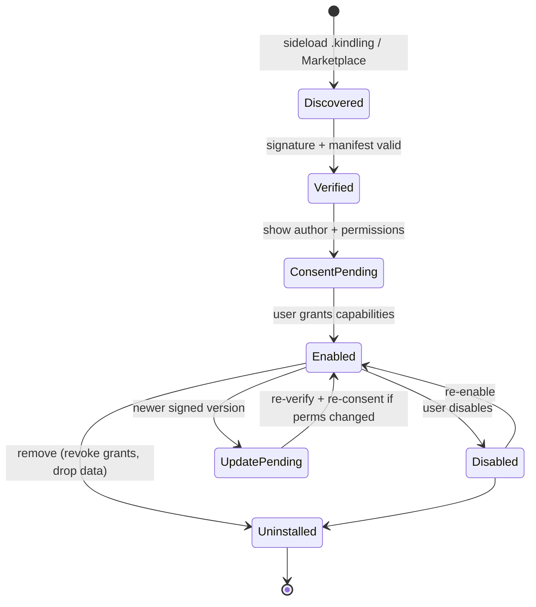

# Epic 3, Extensions (Kindling)

**Phase:** 5 · **Build prompts:** P7.1–P7.6 · **Acceptance:** `AC-EXT-*`
**Depends on:** the automation runtime, API host, and permission broker (epic 1); `key-manager`/`seal` (signing); `ffi`; the four editors + Ember + Seal.
**Enables:** Marketplace distribution (epic 5), Hallmark anchor providers as a Seal contribution point (epic 4), storage providers as a contribution point (epic 6).

---

## 1. Summary & goals

Let users (and third parties) build **Kindling**, packaged, signed, permissioned extensions that add capabilities to **Writer, Sheets, Calendar, Records, Ember and Seal**. A Kindling is the durable, shareable sibling of a macro (epic 1): same sandbox, same API, same permission model, plus a manifest, contribution points, versioning, a lifecycle, an author signature, and an SDK.

**Goals**
1. A **manifest + package format** (`.kindling`) declaring identity, version, contribution points, and capabilities.
2. **Host contribution points** for all six surfaces (see §3.2).
3. A **lifecycle** (install → consent → enable → update → disable → uninstall) with verified signatures and legible permissions.
4. An **Extension SDK**: TypeScript types, a scaffolding CLI, a local dev/test harness with hot reload, and a packaging/signing tool.
5. **Sideload and Marketplace** install paths, both signature‑verified.

**Non‑goals**
- No privileged/native Kindling in v1, all run in the JS sandbox; native acceleration is a future, separately‑audited capability `[IMPL CHOICE]`.
- No ambient network, a Kindling that needs the network declares `net.fetch:<host>` and the user consents (zero‑egress default preserved).

---

## 2. Design rationale

- **Kindling = packaged macro.** Reusing epic 1's engine, API host, broker, and governor means a Kindling cannot do anything a macro can't; it just persists, contributes UI, versions, and ships with provenance. One runtime to audit, not two.
- **Contribution points, not patching.** A Kindling never mutates Hearth Suite's code; it *registers* contributions (a Sheets function, a Records field type, an Ember tool, a Seal anchor provider) at well‑defined extension points. The host owns the surface; the Kindling fills declared slots. This keeps upgrades safe and isolation clean.
- **Signed, legible provenance.** Every Kindling is signed with the author's ML‑DSA identity (same stack as Seal). The client verifies before enabling and shows author + permissions in plain language. The optional Key Directory transparency log (v1 P3.2) lets users detect a substituted author key.
- **Ember tools stay on‑device.** A Kindling can give Ember new *skills/tools*, but those tools run in the same sandbox with the same `net` rules, extending the assistant never punctures the zero‑egress promise unless the user explicitly grants a host.
- **Seal contribution points are how epics 4 & 6 plug in.** Hallmark anchor providers and cloud storage providers are themselves Seal/storage contribution points, so first‑party and third‑party providers use the identical interface (dogfooding the extension model).

---

## 3. Architecture

### 3.1 Crate & package
- **`crates/extensions`** (new): manifest schema + validation, package (`.kindling`) read/verify, signature verification (via `key-manager`), the **contribution registry** (what each host exposes and what's currently registered), the **lifecycle** state machine, and the permission‑consent bridge to the epic‑1 broker. Depends on `automation` (to run contribution code) and `key-manager` (to verify signatures). Adds no new crypto.
- **Package `.kindling`** = a signed ZIP: `manifest.json`, one or more compiled JS modules, assets, an optional `.d.ts`, a `LICENSE`, and a detached ML‑DSA signature over a canonical manifest+content hash.

```jsonc
// manifest.json (illustrative)
{
  "id": "com.example.invoice-tools",
  "name": "Invoice Tools",
  "version": "1.2.0",
  "author": { "name": "Example Co", "identity": "ml-dsa:…pubkey…" },
  "license": "Apache-2.0",
  "engines": { "hearth": ">=1.1.0" },
  "capabilities": ["records.read:Invoices", "sheets.write:current", "ember.run"],
  "contributes": {
    "sheets": { "functions": [{ "name": "INVOICE_TOTAL", "entry": "fns.js#invoiceTotal" }] },
    "records": { "fieldTypes": [{ "type": "currency", "entry": "fields.js#currency" }] },
    "writer": { "commands": [{ "id": "insertInvoice", "title": "Insert invoice", "entry": "cmd.js#insert" }] },
    "ember": { "tools": [{ "name": "lookup_invoice", "entry": "tools.js#lookup" }] },
    "seal": {},
    "calendar": {}
  }
}
```

### 3.2 Contribution points by host

| Host | Contribution points (v1 of this epic) |
|------|---------------------------------------|
| **Writer** | commands & menu items; custom block types; document transforms; exporters/importers; side panels |
| **Sheets** | custom functions; custom cell renderers/formats; chart types; importers |
| **Records** | field types; views; validators; report templates; importers |
| **Calendar** | calendar/contact sources; event actions; reminder providers |
| **Ember** | tools/skills (callable by the local model); prompt packs; local RAG source adapters, all on‑device |
| **Seal** | **anchor providers (Hallmark, epic 4)**; recipient resolvers; attestation/notary back‑ends; key‑transport adapters |
| *(cross‑cutting)* | **storage providers (Connections, epic 6)**; The Mantel commands; settings panels |

### 3.3 Lifecycle


- **Re‑consent on permission change:** an update that requests new capabilities cannot silently inherit consent; the user re‑approves the delta.
- **Per‑Kindling data:** namespaced, sandboxed storage (no access to other Kindling's data or arbitrary store rows).
- **Failure isolation:** a crashing/over‑budget Kindling is disabled with a notice; it cannot take down the host or other Kindling (governor from epic 1 applies per‑invocation).

### 3.4 Extension SDK
- `@hearth/extension-sdk`: generated `.d.ts` for the whole Hearth Automation API + contribution interfaces; a `create-kindling` scaffolder; a **dev harness** that loads an unpacked Kindling into a dev build with hot reload and a permission inspector; and a `kindling pack`/`kindling sign` CLI (signs with the developer's identity, emits `.kindling`).
- Examples for each host (a Sheets function, a Records field type, an Ember tool, a Seal anchor provider stub).

### 3.5 FFI & data‑model delta
- **FFI:** `ext.install/verify/enable/disable/uninstall/list`, `ext.contributions(host)`, `ext.invoke(contributionRef, args)`, `ext.grant/revoke`.
- **Store:** `EXTENSION { uuid id PK, string ext_id, string version, blob package_hash, blob author_sig, string state, timestamp installed_at }`, `EXTENSION_GRANT { uuid id PK, uuid ext_id FK, string capability, string scope, timestamp granted_at }`, `EXTENSION_DATA { uuid id PK, uuid ext_id FK, string key, blob value }` (namespaced, content‑free in indexes per AC‑DATA‑1).

---

## 4. Security & privacy model
1. **Same sandbox as macros.** No ambient authority; deny‑by‑default; governor‑bounded per invocation (epic 1).
2. **Signed & verified before enable.** ML‑DSA signature over manifest+content; verification failure blocks enabling. Author shown; transparency‑log check available.
3. **Declared, scoped, re‑consented capabilities.** Manifest declares; user consents; updates re‑consent on any new capability. `net.*` off by default.
4. **Contribution isolation.** A Kindling only fills declared slots; it cannot read other Kindling's data, the user's identity keys, or un‑granted documents.
5. **Ember & Seal extensions respect their guarantees.** Ember tools run on‑device; Seal contribution points (anchor providers) only ever handle a hash/signature for Hallmark, never plaintext content (epic 4).
6. **Kill switch.** A Kindling can be disabled instantly; uninstall revokes all grants and drops its namespaced data.

---

## 5. Build prompts

### P7.1, Kindling manifest & package format
```
In a new `extensions` crate, define the Kindling manifest schema (id, name, version, author{name,identity}, license, engines, capabilities[], contributes{per‑host}) with strict validation, and the `.kindling` package format: a ZIP of manifest.json, compiled JS modules, assets, optional .d.ts, LICENSE, and a detached ML‑DSA signature over a canonical hash of manifest+content. Implement read, validate, and signature verification (via key-manager), refusing malformed or signature‑mismatched packages. Add fixtures (valid, tampered, unsigned) and tests asserting accept/reject behaviour.
Satisfies: AC-EXT-1, AC-EXT-2.
```

### P7.2, Contribution registry & host points
```
Implement the contribution registry in `extensions`: a typed catalogue of host extension points (Writer commands/blocks/transforms/exporters/panels; Sheets functions/renderers/charts/importers; Records field‑types/views/validators/reports; Calendar sources/actions/reminders; Ember tools/prompt‑packs/RAG‑adapters; Seal anchor‑providers/recipient‑resolvers/attestation; cross‑cutting storage‑providers + Mantel commands + settings). Implement register/unregister on enable/disable and `contributions(host)` + `invoke(ref,args)` running contribution code in the epic‑1 sandbox under the Kindling's grants. Add tests: a Sheets function and a Records field type registered by a Kindling are usable in the editors and stop working when the Kindling is disabled.
Satisfies: AC-EXT-3, AC-EXT-6.
```

### P7.3, Lifecycle, consent & isolation
```
Implement the Kindling lifecycle state machine (Discovered→Verified→ConsentPending→Enabled⇄Disabled→UpdatePending→Uninstalled) in `extensions`, with: plain‑language author + permission consent before enable; re‑consent of the capability delta on updates that add permissions; namespaced per‑Kindling sandboxed data; per‑invocation governor isolation so a faulty Kindling is auto‑disabled without affecting the host or others; and uninstall that revokes grants and drops data. Add EXTENSION / EXTENSION_GRANT / EXTENSION_DATA to the store with migrations. Add tests for the full lifecycle, the update re‑consent path, data namespacing, and the auto‑disable on repeated failure.
Satisfies: AC-EXT-4, AC-EXT-7, AC-EXT-8.
```

### P7.4, FFI & management UI
```
Extend `ffi` with ext.install/verify/enable/disable/uninstall/list, ext.contributions(host), ext.invoke, ext.grant/revoke; regenerate the TS client. Build an "Extensions" manager in The Mantel: installed Kindling, version, author + verification status, granted permissions (with revoke), enable/disable toggles, update prompts, and a sideload (open .kindling) path that always shows author + permissions before enabling. Add binding/integration tests for install→consent→enable→invoke→uninstall.
Satisfies: AC-EXT-9, extends AC-FFI-1.
```

### P7.5, Extension SDK & dev harness
```
Build `@hearth/extension-sdk`: generated TypeScript types for the full Hearth Automation API and all contribution interfaces; a `create-kindling` scaffolder with examples for each host (a Sheets function, a Records field type, an Ember tool, a Seal anchor‑provider stub); a dev harness that loads an unpacked Kindling into a dev build with hot reload and a live permission inspector; and a `kindling pack`/`kindling sign` CLI that signs with the developer identity and emits a `.kindling`. Document the authoring workflow end‑to‑end. Add a test that a scaffolded example packs, signs, installs, and runs.
Satisfies: AC-EXT-5, AC-EXT-10.
```

### P7.6, Provenance & transparency
```
Integrate Kindling signing/verification with the v1 identity stack and the optional Key Directory transparency log (P3.2): show the author identity, allow users to verify the author key against the transparency log, and warn on key substitution or a downgrade attack (older signed version offered after a newer one was seen). Persist the last‑seen version per Kindling. Add tests: a substituted author key is flagged; a version downgrade is refused/ warned.
Satisfies: AC-EXT-11.
```

---

## 6. Acceptance criteria

**AC-EXT-1, Valid package format**
```
Given a .kindling package
When opened
Then its manifest validates, its contents match the signed hash, and its declared capabilities and contributions are parsed.
```

**AC-EXT-2, Signature enforced**
```
Given an unsigned or tampered Kindling
When installation is attempted
Then it is refused with a clear reason; only a valid ML‑DSA‑signed package can be enabled.
```

**AC-EXT-3, Contributes to all six hosts**
```
Given Kindling targeting Writer, Sheets, Calendar, Records, Ember and Seal
When enabled
Then each registered contribution (command, function, field type, calendar source, Ember tool, Seal anchor provider) is available in its host.
```

**AC-EXT-4, Consent before power**
```
Given a Kindling requesting capabilities
When the user installs it
Then author and plain‑language permissions are shown and must be granted before any contribution code runs.
```

**AC-EXT-5, SDK authoring loop**
```
Given the Extension SDK
When a developer scaffolds, runs the dev harness with hot reload, packs, and signs
Then a working .kindling is produced and installs/runs in Hearth Suite.
```

**AC-EXT-6, Clean disable**
```
Given an enabled Kindling
When disabled
Then all its contributions stop working immediately and the host is unaffected.
```

**AC-EXT-7, Update re‑consent**
```
Given an update that requests new capabilities
When applied
Then the user must approve the new capability delta; existing consent does not silently extend.
```

**AC-EXT-8, Isolation & failure containment**
```
Given a Kindling that crashes or exceeds resource budgets
When it runs
Then it is contained (auto‑disabled with a notice) without affecting the host or other Kindling, and it cannot access other Kindling's data or the user's identity keys.
```

**AC-EXT-9, Manageable lifecycle**
```
Given installed Kindling
When the user opens the Extensions manager
Then they can view author/verification/permissions, revoke a permission, disable/enable, update, sideload, and uninstall (which revokes grants and drops data).
```

**AC-EXT-10, Ember tools stay local**
```
Given a Kindling that adds an Ember tool
When Ember invokes it
Then it runs in the sandbox on‑device with no network egress unless a net.fetch:<host> capability was explicitly granted.
```

**AC-EXT-11, Provenance & anti‑substitution**
```
Given the Key Directory transparency log
When a Kindling's author key is substituted or an older version is offered after a newer one
Then the client detects and warns about the substitution/downgrade.
```

---

## 7. Open `[IMPL CHOICE]` points
- Native/WASM‑accelerated Kindling (separately audited), deferred.
- Whether Kindling may declare dependencies on other Kindling, and how that resolves offline.
- Package extension naming (`.kindling` vs `.hext`).
- How much of the contribution catalogue ships in this epic vs grows over time (recommend: ship Writer/Sheets/Records/Ember + Seal anchor‑provider point first; Calendar sources and storage providers can land with epics 4/6).
