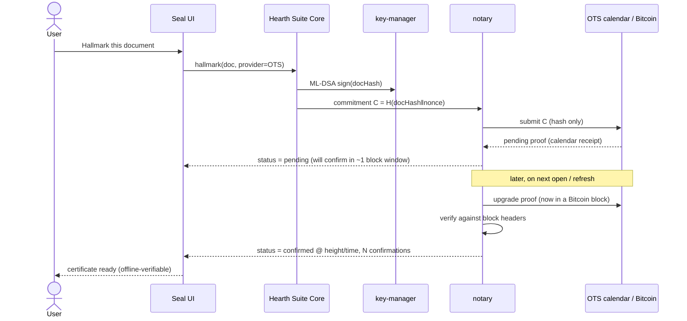

# Epic 4, Hallmark: Proof of Sovereignty via Blockchain

**Phase:** 6 · **Build prompts:** P8.1–P8.6 · **Acceptance:** `AC-HALL-*`
**Depends on:** `seal`, `key-manager` (ML‑DSA signatures, identity), `bundle`, `store`, `ffi`; the Seal anchor‑provider contribution point (epic 3, P7.2), first‑party providers are built against it.
**Theme:** This is one of the three deliberate, opt‑in network features (see [README §3.4](README.md#34-one-explicit-network-posture)). It transmits **only a non‑reversible commitment**, never content.

---

## 1. Summary & goals

Let a user **prove sovereignty of a document**, *"this identity asserted authorship of exactly this content, at or before this time"*, by recording the document's fingerprint on a public blockchain. We call this a **Hallmark** (after the assay‑office marks that prove a silver item's origin and authenticity). A Hallmark combines two independently verifiable facts:

1. **Authorship**, the user's **ML‑DSA** identity signature over the document hash (reuses Seal/`key-manager`).
2. **Existence / priority in time**, a blockchain **anchor** of that signed hash, so anyone, forever, without trusting Hearth Suite or Veldris, can verify the document existed and was claimed by that identity at/before the block's timestamp.

**Goals (the user verbs requested)**
- **Use**, Hallmark a document; view and share its certificate.
- **Check**, verify any Hallmark (ideally offline against chain headers); show pending/confirmed status and confirmations.
- **Diagnose**, health of calendar/anchor servers, node connectivity, wallet, stuck/under‑priced transactions.
- **Top up**, for the optional self‑custodied anchor mode: see balance, estimate fees, get low‑balance warnings, and be guided to top up.

**Non‑goals**
- Not a DRM or access‑control mechanism (that's Seal). A Hallmark is a public, timestamped attestation; it does not encrypt or restrict.
- Not a notarisation *legal opinion*, it's cryptographic evidence; legal weight is jurisdictional `[IMPL CHOICE for product copy]`.

---

## 2. Choosing the chain (the core decision)

The requirement is **proof of existence + authorship anchoring of a hash**, for a privacy‑first, no‑account, "costs nothing by default" product. We do **not** need smart contracts, a token economy, or on‑chain storage of content, we need cheap, permanent, trustless, independently verifiable timestamping of a 32‑byte commitment.

### 2.1 Decision matrix

| Option | Cost / doc | Trust model | Offline‑verifiable | Permanence | Account/token needed | Fit |
|--------|-----------|-------------|--------------------|-----------|----------------------|-----|
| **OpenTimestamps → Bitcoin** | ~free (aggregated) | trustless (Bitcoin PoW) | yes (Bitcoin headers) | maximal | **none** | ★ best default |
| Bitcoin direct `OP_RETURN` | a tx fee | trustless | yes | maximal | wallet + funds | best self‑custodied tier |
| Ethereum L1 (calldata/event) | high fee | trustless | header/light‑client | high | wallet + funds | too costly |
| EVM L2 rollup | low fee | trust varies by rollup/DA | harder (rollup proofs) | depends on DA | wallet + funds | lower‑fee alt |
| Arweave | pay‑once | storage‑incentivised | indirect | high (storage) | token | storage, not timestamp |
| Private/permissioned chain | n/a | trusts operator | no | operator‑bound | n/a | violates sovereignty |

### 2.2 Recommendation

**Default and recommended: OpenTimestamps anchored to Bitcoin.**

Rationale, point‑by‑point against Hearth Suite's principles:
- **Costs nothing, no account.** OTS calendar servers aggregate thousands of hashes into one Bitcoin transaction via a Merkle tree, so the marginal cost per document is effectively zero and the user needs **no wallet, no token, no account**, exactly matching "requires no account, costs nothing."
- **Trustless & maximally permanent.** Bitcoin is the most secure, longest‑lived public ledger; a proof's validity rests on Bitcoin's proof‑of‑work, not on any company.
- **Offline‑verifiable forever.** An OTS proof + the Bitcoin block headers is enough to verify; no need to ever contact Hearth Suite, Veldris, or even the calendar server again. This is the strongest possible match for a *sovereignty* claim.
- **Privacy‑preserving.** Only a hash leaves the device, and we salt it (below) so it reveals nothing about content or even that a document exists until the user reveals the commitment.
- **Open.** OTS is an open standard with open implementations, consistent with Hearth Suite's open‑licence stance.

**Optional self‑custodied tier: direct Bitcoin `OP_RETURN` anchor**, for users who want an *immediate, address‑bound, single‑transaction* record under their own wallet (a stronger, identity‑linked on‑chain footprint, and no dependency on calendar servers). This tier is where **top‑up / balance / fee‑diagnose** live, because it is the only mode that spends funds. It reuses the **same Bitcoin verification stack** as OTS, so we maintain one verifier.

**Extensibility:** anchor back‑ends are a **Seal contribution point** (epic 3). We ship two first‑party providers (OTS/Bitcoin; direct OP_RETURN/Bitcoin) and document an **EVM‑L2 provider** as a community‑extensible lower‑fee alternative `[IMPL CHOICE]`. The product is not married to one chain, but its *default* is the one that best honours the ethos, and its *verification* is anchored in Bitcoin.

> One‑line answer: **Bitcoin is the chain**, free and trustless via OpenTimestamps by default, self‑custodied via OP_RETURN when the user wants a wallet‑bound mark, with other chains available as pluggable providers.

---

## 3. Architecture

### 3.1 What gets published (and what never does)
- Compute `docHash = SHA‑256(canonical document bytes)`.
- Compute a **salted commitment** `C = SHA‑256(docHash ‖ nonce)`, where `nonce` is stored locally in the Bundle. **Only `C` is published.** This prevents anyone from confirming a guessed document, or even learning that *a* document was anchored, until the user chooses to reveal `docHash` + `nonce`. (Content confidentiality is absolute; this also protects metadata.)
- The user's **ML‑DSA signature** over `docHash` is stored in the Hallmark certificate (and optionally also committed) to bind authorship to the timestamp.
- **Nothing else** crosses the network. No filename, no content, no identity in cleartext on‑chain.

### 3.2 The Hallmark certificate
A portable artifact stored with the document/Bundle and exportable as a file: `{ docHash, nonce(optional/redactable), authorSig(ML‑DSA), authorPubKey, provider, anchorRef (txid / OTS proof), status, blockHeight, blockTime, confirmations }`. It is self‑verifying given chain headers.

### 3.3 Crate & flow
- **`crates/notary`** (new): `provider` trait (`anchor(commitment) -> AnchorRef`, `status(ref) -> Status`, `verify(commitment, ref, headers) -> Proof`); first‑party `ots` and `btc_op_return` providers; a light **header store** (Bitcoin block headers for offline verification, updated opt‑in); a `wallet` module (self‑custodied tier: balance, fee estimation, build/sign/broadcast OP_RETURN, key stored in the encrypted vault); and `diagnose` (server/node/wallet health). Depends on `seal`/`key-manager` for the authorship signature; **adds no new secret‑crypto primitives** (anchoring and Bitcoin script are not confidentiality crypto).



### 3.4 Data‑model delta
- `HALLMARK { uuid id PK, uuid document_id FK, blob doc_hash, blob nonce, blob author_sig, string provider, blob anchor_ref, string status "pending|confirmed|failed", int block_height NULL, timestamp block_time NULL, int confirmations, timestamp created_at }`
- `WALLET { uuid id PK, string provider, blob pubkey, blob privkey_encrypted, int balance_cached, timestamp synced_at }` (self‑custodied tier only; private key encrypted at rest per AC‑SEC‑8).
- Bitcoin headers cached in a small local table for offline verification.

---

## 4. The four user verbs

- **Use (Hallmark).** From the Seal panel: "Prove sovereignty of this document." Pick provider (default OTS, free). One tap. Plain‑language status: "Sovereignty pending, will be permanently recorded within ~the next hour" → "Recorded on Bitcoin on 2 June 2026; anyone can verify this is yours."
- **Check (verify).** Open any document or import a certificate → **Verify**: recompute `docHash`, check the ML‑DSA author signature, and verify the anchor against cached Bitcoin headers (offline if headers are current; otherwise fetch headers only). Show: valid/invalid, identity, block height/time, confirmations. Verifying someone else's Hallmark works the same way and needs no Hearth Suite account.
- **Diagnose.** A health panel: OTS calendar server reachability, header‑chain freshness, (self‑custodied) node/electrum endpoint connectivity and wallet sync, plus per‑Hallmark status (pending too long? fee too low? stuck tx? → guided remedies like fee bump / re‑broadcast / re‑submit to another calendar).
- **Top up.** Self‑custodied tier only: show wallet address + cached balance, estimate the fee for the next anchor, warn when balance is below the threshold for *N* future Hallmarks, and present a clear top‑up flow (show/copy/QR the receive address; never custody funds for the user). OTS mode shows "No top‑up needed, Hallmarking is free in this mode."

---

## 5. Security & privacy model
1. **Content never leaves the device**, only a salted commitment is published; the nonce stays local and redactable in the certificate. AC‑STO‑2 / AC‑DATA‑1 / the zero‑knowledge posture are preserved.
2. **Explicit, opt‑in egress.** Hallmarking and verifying are the only actions here that touch the network, always user‑initiated, and surfaced as such. Header updates are opt‑in.
3. **Self‑sovereign verification.** A confirmed Hallmark is verifiable by anyone, forever, with only chain headers, no dependency on Veldris infrastructure (which is why a private/permissioned chain was rejected).
4. **Wallet keys protected.** Self‑custodied wallet private keys are encrypted at rest in the vault (AC‑SEC‑8), recoverable per the identity recovery model `[IMPL CHOICE: separate wallet seed vs derived]`. Hearth Suite never custodies user funds.
5. **No false assurance.** UI never claims legal notarisation; it states precisely what's proven ("existence + authorship claim at/before time T").

---

## 6. Build prompts

### P8.1, Notary crate & anchor‑provider trait
```
Create the `notary` crate and define the anchor‑provider trait: anchor(commitment)->AnchorRef, status(ref)->Status, verify(commitment, ref, headers)->Proof. Implement commitment construction: docHash = SHA‑256(canonical doc bytes); published commitment C = SHA‑256(docHash ‖ local nonce). Implement the authorship binding via key-manager (ML‑DSA sign of docHash) and the Hallmark certificate structure (docHash, nonce[redactable], authorSig, authorPubKey, provider, anchorRef, status, height, time, confirmations). Wire anchor providers to the Seal contribution point so first‑party and third‑party providers share one interface. Add unit tests for commitment/salting and certificate (de)serialisation. CRITICAL: only the commitment C is ever emitted; assert no content or unsalted docHash is transmitted.
Satisfies: AC-HALL-1, AC-HALL-7.
```

### P8.2, OpenTimestamps (Bitcoin) provider [default]
```
Implement the OpenTimestamps provider in `notary`: submit the commitment to OTS calendar servers, store the pending proof, and later upgrade it to a Bitcoin‑confirmed proof. Maintain a small local Bitcoin block‑header store (opt‑in updates) so proofs verify OFFLINE against headers. Implement status (pending/confirmed + confirmations + height/time) and verify (recompute commitment, check the OTS Merkle path to a Bitcoin block, validate against headers). This provider requires no wallet, no token, and no account. Add tests with recorded OTS proofs and headers: a valid proof verifies offline; a tampered commitment or proof fails.
Satisfies: AC-HALL-2, AC-HALL-3 (default, free, offline‑verifiable).
```

### P8.3, Self‑custodied Bitcoin OP_RETURN provider & wallet
```
Implement the direct OP_RETURN provider and a self‑custodied wallet module in `notary`: generate/store a wallet keypair (private key encrypted at rest in the vault, AC‑SEC‑8), query balance and estimate fees via a configurable Electrum/Esplora endpoint [IMPL CHOICE], and build/sign/broadcast a transaction embedding the commitment in an OP_RETURN (~80 bytes). Verify these anchors against the same Bitcoin header store as P8.2. Never custody user funds. Add tests (against a regtest/signet fixture) for build→sign→verify and for a fee‑too‑low / unconfirmed path surfacing a stuck‑tx status.
Satisfies: AC-HALL-4, AC-HALL-8.
```

### P8.4, Verify, diagnose & top‑up surfaces
```
Build the Seal‑panel UX for Hallmark: USE (Hallmark a document; pick provider; plain‑language pending→confirmed status). CHECK (Verify this/any document or imported certificate: recompute docHash, check ML‑DSA author signature, verify anchor against cached headers offline where possible; show identity, height/time, confirmations; verifying others' Hallmarks needs no account). DIAGNOSE (health panel: OTS calendar reachability, header freshness, node/wallet connectivity, and per‑Hallmark remedies for stuck/under‑priced anchors). TOP UP (self‑custodied only: address + QR, cached balance, fee estimate, low‑balance warning for N future Hallmarks, guided top‑up; OTS mode shows "free, no top‑up needed"). Add FFI: notary.hallmark/status/verify/diagnose, wallet.balance/estimate/topupInfo. Add tests for the verify and diagnose flows.
Satisfies: AC-HALL-5, AC-HALL-6, AC-HALL-9, extends AC-FFI-1.
```

### P8.5, Data model, portability & sharing
```
Add HALLMARK and WALLET to the store with migrations (wallet private key encrypted at rest). Persist Bitcoin headers for offline verification. Make the Hallmark certificate exportable as a portable file and embeddable in the Bundle so it travels with the document (AC‑BND‑3); verifying an exported certificate on a clean install works offline given current headers. Allow the user to redact the nonce when sharing a certificate publicly vs privately (public reveal lets a third party verify docHash↔commitment). Add tests for portability and the redacted/revealed verification paths.
Satisfies: AC-HALL-10.
```

### P8.6, Pluggable EVM‑L2 provider (reference) [IMPL CHOICE]
```
As a reference for the extensibility of anchor providers, implement (or scaffold + document) an EVM‑L2 anchor provider against the Seal contribution point: write the commitment to an L2 (calldata/event), read back status/confirmations, and verify. Clearly document its different trust/permanence trade‑offs vs Bitcoin (data‑availability dependence) so users choose informedly, and reuse the same wallet/top‑up/diagnose abstractions. This provider is optional and must not be the default. Add a test proving a third‑party provider can be registered and used without core changes.
Satisfies: AC-HALL-11.
```

---

## 7. Acceptance criteria

**AC-HALL-1, Only a salted commitment is published**
```
Given a document being Hallmarked
When the anchor is created
Then only C = SHA‑256(docHash ‖ nonce) is transmitted; no content, filename, identity, or unsalted hash leaves the device, and the nonce is stored locally.
```

**AC-HALL-2, Default mode is free and account‑free**
```
Given the default (OpenTimestamps) provider
When a user Hallmarks a document
Then it succeeds with no wallet, no token, and no account, at no per‑document cost.
```

**AC-HALL-3, Offline verification against Bitcoin**
```
Given a confirmed Hallmark and current Bitcoin headers
When verified
Then verification succeeds entirely offline (no call to Hearth Suite/Veldris), proving existence at/before the block time.
```

**AC-HALL-4, Self‑custodied anchor works**
```
Given the OP_RETURN provider with a funded wallet
When the user Hallmarks a document
Then a transaction embedding the commitment is broadcast, later confirms, and verifies against the same Bitcoin headers.
```

**AC-HALL-5, Authorship is bound**
```
Given a Hallmark certificate
When checked
Then the ML‑DSA author signature over docHash verifies against the author's public key, binding identity to the timestamp.
```

**AC-HALL-6, Check any document/certificate**
```
Given a third party with a Hallmark certificate and the revealed docHash+nonce
When they verify
Then they confirm the content hash matches the commitment and the anchor is on‑chain, with no Hearth Suite account required.
```

**AC-HALL-7, Content confidentiality preserved**
```
Given Hallmarking is used
When the network is monitored and the chain inspected
Then nothing reversible to content (or to the existence of a specific document) is observable until the user reveals the nonce.
```

**AC-HALL-8, Wallet keys protected & funds never custodied**
```
Given the self‑custodied wallet
When the keystore is inspected
Then the private key is encrypted at rest, and Hearth Suite never holds or moves user funds beyond the user‑initiated anchor transaction.
```

**AC-HALL-9, Diagnose surfaces real problems**
```
Given a stuck/under‑priced anchor or an unreachable server/node
When the user opens Diagnose
Then the specific problem and a concrete remedy (fee bump, re‑broadcast, re‑submit, refresh headers) are shown.
```

**AC-HALL-10, Portable & shareable**
```
Given a Hallmark certificate embedded in a Bundle or exported as a file
When the Bundle/file is opened on another device
Then the certificate is present and verifiable (offline given current headers), with selectable nonce redaction for public vs private sharing.
```

**AC-HALL-11, Pluggable providers**
```
Given the Seal anchor‑provider contribution point
When a non‑default provider (e.g. an EVM‑L2) is registered
Then it can Hallmark/verify without core changes, and the default remains OpenTimestamps/Bitcoin.
```

**AC-HALL-12, Honest claims**
```
Given the Hallmark UI
When status and certificates are shown
Then they state precisely what is proven (existence + authorship claim at/before a time) and never assert legal notarisation or access control.
```

---

## 8. Open `[IMPL CHOICE]` points
- Wallet seed: a separate wallet seed vs derived from the identity recovery phrase (separate recommended for blast‑radius isolation).
- Default node access for the OP_RETURN tier: bundled light client vs configurable Electrum/Esplora endpoint (default: configurable, with a sensible public default the user can change).
- Whether to also commit the ML‑DSA signature on‑chain or keep it certificate‑side only (default: certificate‑side; commitment stays a single hash).
- Which additional provider(s) ship first‑party beyond Bitcoin (EVM‑L2 reference is optional).
- Product copy on legal weight (jurisdiction‑dependent; coordinate with counsel).
