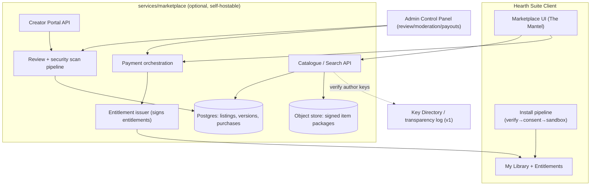
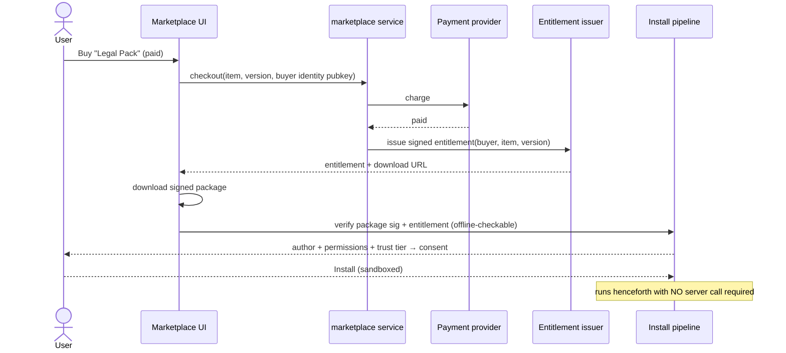

# Epic 5, Marketplace

**Phase:** 7 · **Build prompts:** P9.1–P9.6 · **Acceptance:** `AC-MKT-*`
**Depends on:** Extensions/Kindling signing & packaging (epic 3), macros (epic 1), `key-manager` + the optional Key Directory/transparency log (v1 P3.2), the v1 Admin Control Panel (P3.4), the v1 cloud‑service patterns (self‑hostable, Rust + Postgres + object store).
**Theme:** An **optional**, self‑hostable service. The core suite never requires it; the privacy and offline promises are untouched for users who never open it.

---

## 1. Summary & goals

A **Marketplace** where users discover and obtain **templates** (legal, software‑dev, academic, business, personal…), **macros**, and **extensions (Kindling)**, official (Veldris‑curated) and user‑published. Free and paid items, with creator payouts, but designed so it can't compromise the things that make Hearth Suite Hearth Suite: privacy, offline use, openness, and the sandbox.

**Goals**
1. **Catalogue & discovery**, browse/search by type, category, and trust tier; rich listings with screenshots, permissions, license, version history, ratings.
2. **Safe acquisition**, every code item is signed and verified; permissions are shown *before* install; everything runs in the epic‑1/epic‑3 sandbox.
3. **Commerce without lock‑in**, free, paid (one‑time), and pay‑what‑you‑want; **offline‑verifiable entitlements** (no phone‑home DRM); creator payouts and revenue share.
4. **Curation & moderation**, official review + automated security scanning + community signals; clear trust tiers.
5. **Self‑hostable & federatable**, Veldris runs the official instance; anyone can run their own; clients can add registry URLs (like package registries).

**Non‑goals**
- No ads, no tracking, no engagement manipulation (consistent with Hearth Suite's no‑monetisation‑of‑attention stance).
- No requirement to have an account to *use* free items installed by file; an account is needed only to *purchase* or *publish*.

---

## 2. Design rationale

- **Reuse the trust spine.** Marketplace items are just Kindling/macros/templates that already have signing, permissions, and sandboxing (epics 1 & 3). The Marketplace adds *distribution, discovery, and payment*, not a new execution or trust model. Installing from the Marketplace and sideloading a `.kindling` converge on the same verify‑consent‑sandbox path.
- **Entitlements, not DRM.** A purchase yields a **signed entitlement** (an offline‑verifiable certificate binding buyer identity + item + version) that the client checks **locally**. No server call is required to *run* a purchased item, honouring offline‑first. Revocation/refunds are handled by short‑lived re‑issuance `[IMPL CHOICE]`, never by breaking offline use of an already‑downloaded item.
- **Trust tiers, transparent.** Items are labelled **Official** (Veldris‑reviewed), **Verified publisher** (identity‑checked author), or **Community** (signed but unreviewed). Permissions and trust tier are always visible before install. The sandbox protects users regardless of tier; tiers inform, they don't gate safety.
- **Privacy in the storefront too.** Browsing minimises data; no behavioural profiling. The official instance follows the same no‑telemetry‑by‑default ethos for the *client*; server‑side keeps only what commerce requires.
- **Openness via federation.** Because trust rests on signatures (not on a single gatekeeper), additional registries can be added by URL, and self‑hosters get the same software, preventing the Marketplace from becoming a lock‑in.

---

## 3. Architecture

### 3.1 Service & surfaces
- **`services/marketplace`** (new, Rust): catalogue/search API, listing & version storage, creator portal API, purchase/payment orchestration, entitlement issuance/signing, review & moderation pipeline, and abuse/rate controls. Postgres for metadata; S3‑compatible object store for item packages (already‑signed `.kindling`/macro/template files). Follows v1 cloud patterns: docker‑compose for self‑host, Helm chart for clusters.
- **Client surface:** a **Marketplace** section in The Mantel (browse/search/detail/install/updates/library) and an **install pipeline** that funnels into the existing Kindling/macro/template install (verify → show author+permissions+trust tier → consent → sandbox).
- **Admin module:** extend the v1 Admin Control Panel with review queue, scanning results, takedown/revoke, payout/dispute views, all under existing RBAC + immutable audit log, with **no access to user document content** (AC‑ADMIN‑4 unchanged).
- **Payments:** a pluggable payment provider `[IMPL CHOICE]`; the service orchestrates checkout and records the purchase; the *entitlement* (not the payment) is what the client consumes.



### 3.2 Item types
- **Template**, a Bundle/document template (Writer/Sheets/Records/Calendar layouts, sample data, styles). Data, not code → lowest risk; still signed.
- **Macro**, an epic‑1 script with declared capabilities.
- **Kindling**, an epic‑3 extension package.
- Each listing carries: type, category (legal / software‑dev / academic / business / personal / …), trust tier, version history, declared permissions, license, price model, ratings/reviews, and the author's verified identity.

### 3.3 Acquisition & entitlement flow



### 3.4 Review & safety pipeline
- **Automated:** signature/manifest validation; static scan of declared vs used capabilities (flag a Kindling that calls APIs it didn't declare, rejected); known‑bad pattern scan; license compatibility check (open‑licence preference surfaced).
- **Human (Official tier):** Veldris review for featured/official items.
- **Community signals:** ratings, reviews, install counts, report‑abuse.
- **Post‑publish:** takedown + entitlement‑revocation path for malware/IP violations, with audit trail; already‑installed items can be disabled by the client kill‑switch (epic 3) but offline use isn't silently broken without cause.

### 3.5 Data‑model delta
- **Service (Postgres):** `LISTING`, `VERSION`, `AUTHOR` (identity pubkey, verification status), `PURCHASE`, `ENTITLEMENT`, `REVIEW`, `SCAN_RESULT`, `PAYOUT`. No user document content, ever.
- **Client (store):** `MKT_ENTITLEMENT { uuid id PK, string item_id, string version, blob entitlement_sig, blob issuer_pubkey, timestamp acquired_at }`, plus reuse of `EXTENSION`/`MACRO` tables for installed items. The library lists owned items and verifies entitlements offline.

---

## 4. Security, privacy & commerce model
1. **Sandbox first.** Anything executable is Kindling/macro → epic‑1/3 sandbox + permission consent. Trust tier never relaxes the sandbox.
2. **Declared = used.** A code item whose actual capability use exceeds its declared manifest is rejected at review and refused at install.
3. **Signed everything.** Author ML‑DSA signature + Marketplace signature; verified locally; Key Directory transparency log detects author‑key substitution (AC‑KEYDIR‑3).
4. **Offline‑first commerce.** Purchased items run without contacting the server (signed entitlement checked locally). No phone‑home DRM.
5. **Optional & non‑coercive.** The suite is fully usable having never opened the Marketplace; no account to browse free file‑installs; account only for purchase/publish.
6. **Privacy in storefront.** No behavioural tracking; minimal commerce data; the official instance keeps client‑side telemetry opt‑in and content‑free (AC‑OBS‑1).
7. **Self‑host & federate.** Same software for self‑hosters; clients can add registry URLs; trust rests on signatures, not a single gatekeeper.

---

## 5. Build prompts

### P9.1, Marketplace service: catalogue & listings
```
Build `services/marketplace` (Rust): a catalogue/search API for Templates, Macros, and Kindling with categories (legal, software‑dev, academic, business, personal, …), trust tiers (Official / Verified / Community), version history, declared permissions, license, ratings, and verified author identity. Store metadata in Postgres and signed item packages in an S3‑compatible object store. Provide list/search/detail/versions/download endpoints. Ship docker‑compose (self‑host) and a Helm chart, mirroring v1 cloud‑service conventions. The service stores NO user document content. Add API tests and a seed catalogue.
Satisfies: AC-MKT-1, AC-MKT-9.
```

### P9.2, Creator portal, signing & review pipeline
```
Build the Creator Portal API and the review pipeline. Authors publish a signed package (Kindling/macro/template) with metadata; the pipeline runs automated checks: signature/manifest validity, declared‑vs‑used capability analysis (reject if used > declared), known‑bad pattern scan, and license‑compatibility check. Official‑tier items additionally require human approval (surfaced in the Admin panel). Record SCAN_RESULT and version provenance. Verify author identity against the Key Directory transparency log. Add tests: a package using undeclared capabilities is rejected; a valid package advances to published.
Satisfies: AC-MKT-2, AC-MKT-3.
```

### P9.3, Payments & offline‑verifiable entitlements
```
Implement purchase orchestration and entitlements. Support free, one‑time paid, and pay‑what‑you‑want pricing with a pluggable payment provider [IMPL CHOICE]. On successful payment, issue a signed ENTITLEMENT binding buyer identity + item + version, returned with a download URL. CRITICAL: the client must be able to verify the entitlement and run the item fully OFFLINE thereafter, no server call required to use a purchased item. Implement creator payout records and a refund/revocation path via short‑lived re‑issuance that never silently breaks offline use of an already‑downloaded item without cause. Add tests for entitlement issuance and offline verification.
Satisfies: AC-MKT-4, AC-MKT-5.
```

### P9.4, Client Marketplace surface & install pipeline
```
Build the Marketplace section in The Mantel: browse/search/filter by type+category+trust tier, listing detail (screenshots, permissions, license, version history, ratings), "My Library", and update notifications. Funnel all installs through the existing verify→show(author+permissions+trust tier)→consent→sandbox pipeline (epics 1/3), adding entitlement verification for paid items. Persist MKT_ENTITLEMENT in the store and verify it offline. No account required to browse or to install free file‑based items; account only for purchase. Add tests for install of a free Kindling and a paid template (entitlement‑gated), both ending in the sandboxed/consented state.
Satisfies: AC-MKT-6, AC-MKT-7.
```

### P9.5, Admin moderation, takedown & payouts
```
Extend the v1 Admin Control Panel with a Marketplace module: review queue with scan results, approve/reject, trust‑tier assignment, takedown + entitlement‑revocation (audited), abuse‑report triage, and payout/dispute views, all under existing RBAC + immutable audit log, with NO access to user document content (AC‑ADMIN‑4). Add tests: a takedown is audited and propagates to the catalogue; an unauthorized operator action is denied and logged.
Satisfies: AC-MKT-8 (extends AC-ADMIN-1..6).
```

### P9.6, Federation & registry trust
```
Implement registry federation: the client can add additional Marketplace registry URLs; each registry's items are still verified by author signature and the registry's own signature, and the trust tier/source is shown. Ensure no single registry is privileged in a way that bypasses local signature verification or the sandbox. Document the self‑hosting + federation model. Add tests: an item from a second registry installs through the same verify/consent/sandbox path; a registry cannot serve an item that fails author‑signature verification.
Satisfies: AC-MKT-10.
```

---

## 6. Acceptance criteria

**AC-MKT-1, Catalogue covers all item types & categories**
```
Given the Marketplace
When a user browses
Then templates (incl. legal/software‑dev/academic), macros, and Kindling are discoverable by category and trust tier, with permissions, license, versions, and author shown.
```

**AC-MKT-2, Only signed, scanned items publish**
```
Given a creator submission
When the review pipeline runs
Then unsigned/invalid packages are rejected and an automated security + license scan is recorded before publication.
```

**AC-MKT-3, Declared = used enforced**
```
Given a code item whose runtime capability use exceeds its declared manifest
When reviewed
Then it is rejected; only items whose use matches their declaration are published.
```

**AC-MKT-4, Multiple price models**
```
Given listings
When priced
Then free, one‑time paid, and pay‑what‑you‑want are all supported, with creator payouts recorded.
```

**AC-MKT-5, Offline‑verifiable entitlement (no DRM phone‑home)**
```
Given a purchased item
When the device is offline
Then the entitlement verifies locally and the item installs/runs without any server call.
```

**AC-MKT-6, Install funnels through the trust pipeline**
```
Given any Marketplace install
When it proceeds
Then it is signature‑verified and the author, permissions, and trust tier are shown and consented before the item runs in the sandbox.
```

**AC-MKT-7, Optional & account‑light**
```
Given a user who never opens the Marketplace
When they use Hearth Suite
Then nothing changes; and browsing or installing a free item requires no account (only purchase/publish do).
```

**AC-MKT-8, Moderated with audit, no content access**
```
Given the Admin Marketplace module
When operators review, assign tiers, take down, or process payouts
Then actions are RBAC‑gated and immutably audited, and operators cannot read user document content.
```

**AC-MKT-9, Self‑hostable**
```
Given the provided compose/Helm chart
When deployed
Then a working Marketplace runs without Veldris infrastructure and stores no user document content.
```

**AC-MKT-10, Federation preserves local trust**
```
Given an added third‑party registry
When an item is installed from it
Then it passes the same local author‑signature verification, consent, and sandbox; a registry cannot bypass these.
```

**AC-MKT-11, Trust tiers don't weaken the sandbox**
```
Given an Official‑tier item
When installed
Then it runs under the same sandbox and permission consent as a Community item; the tier informs the user but does not grant extra authority.
```

---

## 7. Open `[IMPL CHOICE]` points
- Payment provider(s) and payout mechanism; tax/VAT handling per jurisdiction.
- Refund/revocation policy mechanics (short‑lived re‑issuance vs grace windows) without harming offline use.
- Whether ratings/reviews require a verified purchase; anti‑abuse/sybil resistance.
- Package extension and registry index format; how federation registries are discovered/trusted.
- Whether template items can bundle sample data and how that interacts with Seal.
