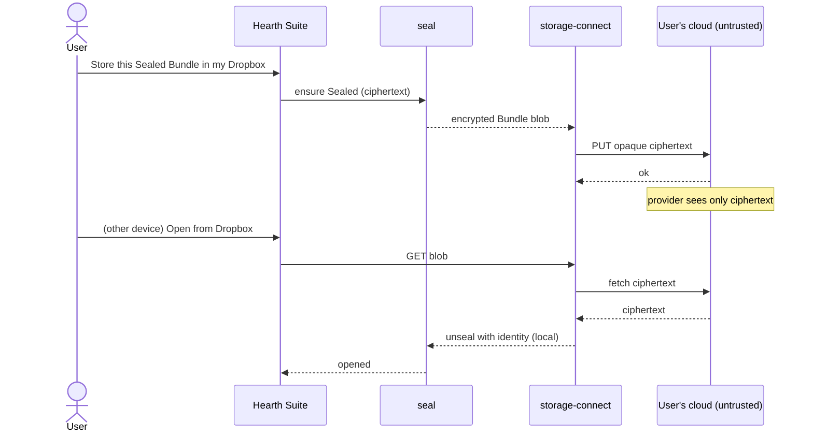

# Epic 6, Connections: External Cloud Storage

**Phase:** 7 · **Build prompts:** P10.1–P10.5 · **Acceptance:** `AC-CONN-*`
**Depends on:** `odf-io` + `legacy-import` (import pipeline), `bundle`/`store`/`seal` (vault, encrypted Bundles), `key-manager` (token storage), `ffi`; the storage‑provider contribution point (epic 3), third‑party providers plug in here.
**Theme:** One of the three deliberate, opt‑in network features ([README §3.4](README.md#34-one-explicit-network-posture)). Egress is per‑action, user‑initiated, and, for the privacy‑preserving mode, ciphertext‑only.

---

## 1. Summary & goals

Let users **connect external cloud storage** and bring documents into Hearth Suite to work on, and, crucially, let users keep their **Sealed** Bundles in their *own* cloud as encrypted blobs the provider can't read. This gives the convenience of "open from Drive/Dropbox/Nextcloud" without abandoning Hearth Suite's privacy stance, by being explicit about *which* mode the user is in.

**Two modes**
1. **Working import**, browse a connected provider, pull in a file (`.docx`/`.xlsx`/ODF/CSV/images/PDF/legacy Works), convert via the existing import pipeline, and work on it **locally**. Optionally keep a link to re‑export/save back.
2. **Encrypted vault storage**, store **Sealed** Bundles in the user's cloud; the provider sees only opaque ciphertext (the "bring your own storage" complement to the v1 zero‑knowledge relay). Sync/backup of Sealed Bundles across the user's devices via their own account.

**Goals**
- First‑class **open protocols**: WebDAV, S3‑compatible, SFTP, Nextcloud, built in.
- Popular consumer clouds (Google Drive, Dropbox, OneDrive, iCloud Drive where the platform allows) via OAuth connectors; additional providers via **Kindling** storage providers.
- A clean **file picker** wired into every "Open/Import" and "Save a copy to…" flow.
- **Honest privacy framing**: clearly mark when content leaves the device unencrypted (working import to/from a third‑party doc) vs when it's ciphertext‑only (encrypted vault storage).

**Non‑goals**
- Not a replacement for the v1 zero‑knowledge sync relay (that's real‑time CRDT co‑editing). Connections is BYO file storage / import.
- No silent background upload of plaintext; every plaintext egress is an explicit user action.

---

## 2. Design rationale

- **Providers behind one trait.** A `StorageProvider` interface (list, stat, get, put, delete, capabilities) lets WebDAV/S3/SFTP/Drive/Dropbox/OneDrive, and third‑party Kindling, share one picker, one import pipeline, and one credential model. Built once.
- **Open protocols first.** WebDAV/S3/Nextcloud cover self‑hosters and the privacy‑minded with no proprietary API; consumer OAuth connectors are added for reach, and exotic ones are pushed to extensions so the core stays lean and open.
- **Two clearly separated modes.** The privacy risk is entirely about *plaintext vs ciphertext*. Rather than blur it, the UI names it: importing a third‑party `.docx` from Drive means that content already lives at Google and a *local working copy* is made; storing a Sealed Bundle means the provider holds only ciphertext. Making this explicit is the design, not a footnote.
- **Credentials in the vault.** OAuth tokens / S3 keys / SFTP creds are stored in the encrypted vault (AC‑SEC‑8), per‑provider, scoped, and revocable. No plaintext tokens at rest or in logs.
- **No new trust in the provider.** For the encrypted mode, the provider is treated exactly like the relay/object store: an untrusted blob bucket. Confidentiality comes from Seal, not from the provider.

---

## 3. Architecture

### 3.1 Crate & surfaces
- **`crates/storage-connect`** (new): the `StorageProvider` trait; built‑in providers (`webdav`, `s3`, `sftp`, `nextcloud`); OAuth flow handling for consumer connectors; a connection registry; and glue to the import pipeline (`odf-io`/`legacy-import`) and to Sealed‑Bundle put/get. Credentials via `key-manager`/vault.
- **UI:** a **Connections** settings area (add/authorise/inspect/revoke a provider) and a **cloud file picker** surfaced inside every Open/Import and "Save a copy to…" flow in The Mantel and the editors, plus an "encrypted vault location" selector for storing Sealed Bundles.
- **FFI:** `conn.add/list/authorize/revoke`, `conn.browse(path)`, `conn.import(ref) -> Bundle/Document`, `conn.exportCopy(doc, ref)`, `conn.vault.put(bundle, ref)/get(ref)/list`.

```mermaid
flowchart TB
    subgraph client["Hearth Suite Client"]
        picker["Cloud file picker"]
        conn["storage-connect\n(StorageProvider trait)"]
        imp["Import pipeline\n(odf-io / legacy-import)"]
        seal["seal (Sealed Bundle put/get)"]
        vault[("Encrypted vault: provider creds")]
    end
    subgraph providers["User's own storage (untrusted)"]
        webdav["WebDAV / Nextcloud"]
        s3["S3‑compatible"]
        sftp["SFTP"]
        oauth["Drive / Dropbox / OneDrive (OAuth)"]
        ext["Kindling storage provider"]
    end
    picker --> conn
    conn --> webdav & s3 & sftp & oauth & ext
    conn -->|working import (plaintext local copy)| imp
    conn -->|encrypted vault (ciphertext only)| seal
    conn --> vault
```

### 3.2 Mode 1, Working import
- Browse provider → pick a file → download → run through `odf-io`/`legacy-import` → open as a Hearth Suite document/Bundle, edited **locally**.
- Optional **link**: remember the source ref so the user can "Save a copy back" (re‑export to the original format), an explicit action, never auto‑sync of plaintext.
- Plain‑language notice the first time: "This file lives in your Google Drive. Hearth Suite makes a working copy on this device. To protect it, Seal it and store it back as an encrypted Bundle."

### 3.3 Mode 2, Encrypted vault storage
- Seal a Bundle (v1) → choose a cloud Connection as its storage location → upload **ciphertext only** (same opaque‑blob property as the relay/object store).
- Retrieve on another device: download the Sealed Bundle, unseal locally with the user's identity. The provider never holds keys or plaintext.
- This is the privacy sweet spot: use commodity cloud storage as an encrypted backup/sync of Sealed Bundles, with confidentiality guaranteed by Seal, not by the provider.



### 3.4 Data‑model delta
- `CONNECTION { uuid id PK, string provider, string display_name, json config, blob credentials_encrypted, json scopes, timestamp added_at, timestamp last_used }` (credentials encrypted at rest).
- `CONNECTION_LINK { uuid id PK, uuid document_id FK NULL, uuid bundle_id FK NULL, uuid connection_id FK, string remote_ref, string mode "import|vault", timestamp linked_at }` (remembered source/destination refs; no content).

---

## 4. Security & privacy model
1. **Per‑action, user‑initiated egress.** Nothing uploads/downloads without an explicit user action; no background plaintext sync.
2. **Mode is explicit.** The UI always shows whether an operation moves plaintext (working import/export to a third‑party file) or ciphertext (encrypted vault storage of a Sealed Bundle).
3. **Provider is untrusted (encrypted mode).** Sealed Bundles are opaque blobs; the provider cannot read content or keys, same guarantee as the v1 relay.
4. **Credentials protected.** Tokens/keys encrypted in the vault (AC‑SEC‑8), scoped to the minimum needed, revocable; never logged or written in plaintext.
5. **OAuth least privilege.** Request the narrowest scopes that support the chosen operations; show granted scopes; allow revocation in‑app and link to the provider's revocation page.
6. **Import safety.** All imported files pass through the fuzzed import pipeline (AC‑SEC‑11) and are validated before processing.
7. **Third‑party providers are Kindling.** They run under the storage‑provider contribution point with the epic‑3 sandbox + permissions; a storage Kindling gets `net.fetch:<host>` for its provider only, and never sees the user's identity keys.

---

## 5. Build prompts

### P10.1, StorageProvider trait & open‑protocol providers
```
Create `storage-connect` and define the StorageProvider trait (list, stat, get, put, delete, capabilities, credential lifecycle). Implement built‑in providers for open protocols: WebDAV, S3‑compatible, SFTP, and Nextcloud. Store all credentials encrypted in the vault via key-manager; never log or persist plaintext tokens. Provide a connection registry (add/list/revoke) and capability flags per provider. Add tests against local mock servers for each provider covering list/get/put/delete and credential round‑trip (encrypted at rest).
Satisfies: AC-CONN-1, AC-CONN-6.
```

### P10.2, OAuth consumer connectors
```
Implement OAuth connectors for Google Drive, Dropbox, and OneDrive (and iCloud Drive where the platform permits [IMPL CHOICE]) behind the StorageProvider trait. Implement the auth code/PKCE flow appropriate to the desktop/mobile clients, request least‑privilege scopes, store refresh/access tokens encrypted in the vault, surface granted scopes, and support in‑app revocation. Add tests with a mock OAuth/provider for authorise→browse→get→token‑refresh→revoke.
Satisfies: AC-CONN-2, AC-CONN-7.
```

### P10.3, Working import (plaintext, local) with optional link
```
Wire storage-connect to the import pipeline: browse a connection, pick a file (.docx/.xlsx/ODF/CSV/images/PDF/legacy .wps/.wks/.wdb), download, convert via odf-io/legacy-import, and open as a local Hearth Suite document/Bundle. Optionally remember the source ref (CONNECTION_LINK) to support an explicit "Save a copy back" re‑export to the original format. Show a first‑time plain‑language notice that the content already lives at the provider and Hearth Suite holds a local working copy, suggesting Seal + encrypted storage to protect it. All imports pass through the validated/fuzzed import pipeline (AC‑SEC‑11). Add tests: import a .docx from a mock provider and round‑trip a copy back.
Satisfies: AC-CONN-3, AC-CONN-8.
```

### P10.4, Encrypted vault storage of Sealed Bundles
```
Implement the encrypted vault mode: select a cloud Connection as the storage location for a Sealed Bundle and upload CIPHERTEXT ONLY; retrieve and unseal locally on any of the user's devices. The provider must only ever receive opaque encrypted blobs (no content, no keys), treat it exactly like the v1 zero‑knowledge object store. Implement conn.vault.put/get/list and conflict‑aware versioning for multi‑device use [IMPL CHOICE: last‑writer‑wins vs CRDT handoff]. Add tests asserting that what is uploaded is indistinguishable from random to the provider and that a Bundle stored on device A opens (after unseal) on device B.
Satisfies: AC-CONN-4, AC-CONN-9.
```

### P10.5, Connections UI, picker & FFI
```
Build the Connections settings area (add/authorise/inspect scopes/revoke a provider) and a cloud file picker surfaced in every Open/Import and "Save a copy to…" flow, plus an encrypted‑vault‑location selector for Sealed Bundles. Always show, per operation, whether plaintext or ciphertext is moving. Extend `ffi` with conn.add/list/authorize/revoke, conn.browse, conn.import, conn.exportCopy, conn.vault.put/get/list and regenerate the TS client. Expose the storage‑provider contribution point so third‑party providers (Kindling) appear in the same picker under the epic‑3 sandbox/permissions. Add binding/integration tests for the picker→import and picker→vault flows.
Satisfies: AC-CONN-5, AC-CONN-10, extends AC-FFI-1.
```

---

## 6. Acceptance criteria

**AC-CONN-1, Open‑protocol providers work**
```
Given WebDAV, S3‑compatible, SFTP, and Nextcloud connections
When the user browses and transfers files
Then list/get/put/delete work for each through one StorageProvider interface.
```

**AC-CONN-2, Consumer clouds via OAuth**
```
Given Google Drive / Dropbox / OneDrive
When the user authorises with least‑privilege scopes
Then they can browse and import, with granted scopes shown and revocable in‑app.
```

**AC-CONN-3, Working import converts correctly**
```
Given a .docx/.xlsx/ODF/CSV/PDF/image/legacy file in a connection
When imported
Then it converts via the import pipeline and opens as a local Hearth Suite document, with an optional remembered link to its source.
```

**AC-CONN-4, Encrypted vault is ciphertext‑only**
```
Given a Sealed Bundle stored to a cloud Connection
When the provider's stored object is inspected
Then it is opaque ciphertext revealing no content or keys (same property as the zero‑knowledge relay).
```

**AC-CONN-5, Mode is always explicit**
```
Given any transfer
When it occurs
Then the UI states whether plaintext (working import/export) or ciphertext (Sealed vault) is moving.
```

**AC-CONN-6, Credentials protected**
```
Given stored provider credentials
When the keystore/logs are inspected
Then tokens/keys are encrypted at rest and never appear in plaintext or logs.
```

**AC-CONN-7, Revocation works**
```
Given an authorised connection
When the user revokes it
Then stored credentials are destroyed and further access requires re‑authorisation.
```

**AC-CONN-8, Import safety**
```
Given a malformed/corrupt file from a connection
When imported
Then it is handled by the validated/fuzzed import pipeline without crashing and with a clear report.
```

**AC-CONN-9, Cross‑device encrypted retrieval**
```
Given a Sealed Bundle stored in the user's cloud from device A
When opened on device B with the same identity
Then it downloads and unseals locally; the provider never holds keys or plaintext.
```

**AC-CONN-10, Third‑party providers are sandboxed**
```
Given a Kindling storage provider
When added
Then it appears in the same picker, runs under the extension sandbox with only its own net.fetch:<host> capability, and never accesses the user's identity keys.
```

**AC-CONN-11, No background plaintext egress**
```
Given default settings
When the client runs
Then no content is uploaded/downloaded without an explicit user action; there is no silent plaintext sync.
```

---

## 7. Open `[IMPL CHOICE]` points
- iCloud Drive support (platform‑restricted API surface).
- Multi‑device conflict strategy for encrypted vault storage (last‑writer‑wins + version history vs CRDT handoff reusing v1 `crdt-sync`).
- Whether "Save a copy back" can become an opt‑in two‑way working sync (with explicit plaintext warning) or stays one‑shot.
- How connections interact with the v1 relay (offer the relay as just another vault target?).
- Which consumer connectors ship first‑party vs as official Kindling.
