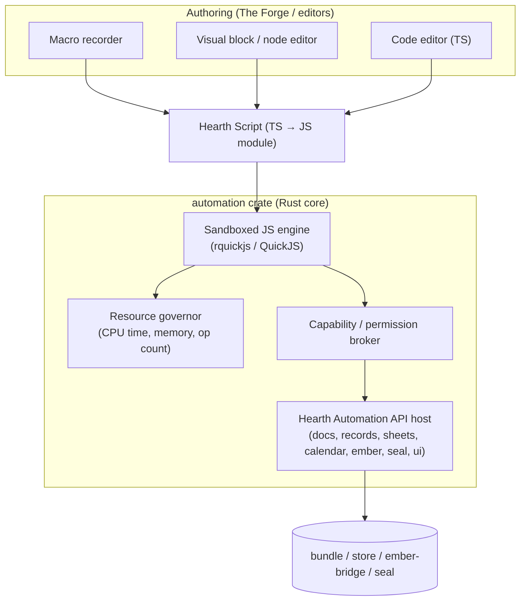

# Hearth Suite, Roadmap: Extensibility, Sovereignty & Ecosystem

**Companion to:** the Hearth Suite v1 architecture (C4 diagrams in `docs/build/diagrams/`), its build prompts and its acceptance criteria.
**Status:** Forward-looking specification for **post‑v1** capability epics (Phases 5–7). Nothing here is as‑built; every doc defines a plan to build, in the same format as the v1 build library.
**Audience:** Engineers using Claude Code / agentic build tools, plus reviewing architects and designers.

> **Read the v1 docs first.** These roadmap docs extend the v1 architecture; they reuse its crates (`bundle`, `seal`, `key-manager`, `store`, `ember-bridge`, `ffi`), its lexicon (Bundle, Seal, Ember, The Mantel, Records), its principles (local‑first, offline‑first, post‑quantum E2E, on‑device AI, open licences, one Rust core + thin clients), and its conventions (Pn.x build prompts; Gherkin `AC-*` criteria; "Definition of Done" = all of a component's ACs pass in CI).

---

## 1. What this roadmap adds

Six tightly‑related epics turn Hearth Suite from a fixed four‑module suite into an **extensible platform**, without surrendering the privacy and offline promises that define it.

| # | Epic | Doc | Phase | Prompts | AC prefix |
|---|------|-----|-------|---------|-----------|
| 1 | **Macros & coding**, a sandboxed automation runtime, a macro recorder, and a typed scripting API across all modules | [01-macros-and-coding.md](01-macros-and-coding.md) | 5 | P5.x | `AC-MAC` |
| 2 | **The Forge**, visual drag‑and‑drop (and describe‑it‑to‑Ember) builders for databases & relationships, queries, functions, sheets, forms, the Bundle organiser, and macro/script construction, each with drop‑to‑code | [02-visual-builders.md](02-visual-builders.md) | 5 | P6.x | `AC-FORGE` |
| 3 | **Extensions (Kindling)**, a user‑authored extension system contributing to Writer, Sheets, Calendar, Records, Ember and Seal | [03-extensions.md](03-extensions.md) | 5 | P7.x | `AC-EXT` |
| 4 | **Hallmark**, Seal proof of sovereignty by anchoring a document fingerprint on a blockchain (use / check / diagnose / top‑up) | [04-seal-sovereignty-hallmark.md](04-seal-sovereignty-hallmark.md) | 6 | P8.x | `AC-HALL` |
| 5 | **Marketplace**, an optional, self‑hostable store for official and user templates, macros and extensions | [05-marketplace.md](05-marketplace.md) | 7 | P9.x | `AC-MKT` |
| 6 | **Connections**, connect external cloud storage to bring documents into Hearth Suite (and store Sealed Bundles in your own cloud) | [06-cloud-connections.md](06-cloud-connections.md) | 7 | P10.x | `AC-CONN` |

Build order matters: epics 1–3 share one runtime and one trust model and should be built together (Phase 5). Epic 4 depends only on `seal`/`key-manager` (Phase 6). Epics 5–6 depend on the extension/signing stack from Phase 5 (Phase 7).

Epics 1 to 6 are the feature set of **Hearth Suite Pro**, the commercial edition. The open-source Hearth Suite stays complete and independently buildable: the four modules, The Mantel, Ember, Seal, formats, local storage and every security update are never gated. Pro attaches to the open core through a public integration seam (FFI namespace registry, store-migration registry, shell UI slot registry, build profiles and a signed first-party pack loader), so anyone can build their own layer against the same seam.

---

## 2. Standing context to prepend to every prompt

> You are building Hearth Suite, an open‑source, offline‑first, privacy‑first productivity suite (the modern heir to Microsoft Works), developed and released open‑source by Veldris Ltd. Core principles: local‑first (works fully offline, no account required), post‑quantum end‑to‑end encryption as a property of the Bundle, on‑device open‑source AI (Ember) with nothing leaving the device by default, and Works‑grade simplicity (progressive depth: calm defaults, advanced power one layer beneath). Lexicon: modules Writer/Sheets/Records/Calendar; AI assistant **Ember**; encryption action **Seal**; unified workspace **The Mantel**; project file **Bundle**; visual builder surface **The Forge**; extension **Kindling**; on‑chain sovereignty proof **Hallmark**. The Rust core is one auditable workspace; clients are thin. Use open licences only. Match the warm "Hearth Suite" design system (ember amber, charcoal, Seal teal). **New, non‑negotiable rule for all of Phase 5+: any code authored by a user (a macro or a Kindling) runs in a deny‑by‑default sandbox with no ambient authority, no filesystem, no network, no document access except through explicitly granted, user‑consented capabilities.**

---

## 3. Cross‑cutting architecture (the platform spine)

These six epics are not six independent features; they are one platform built on four shared pillars. Each epic doc references this section rather than re‑deriving it.

### 3.1 One runtime for all user code
Macros (epic 1) and Kindling (epic 3), and every code item sold in the Marketplace (epic 5), execute in **one** embedded, sandboxed engine in the Rust core (the `automation` crate). A macro is the *personal, lightweight* form of user code; a Kindling is the *packaged, shareable, permissioned* form. They share one language, one API surface (the **Hearth Automation API**), one permission broker, and one resource governor. The visual builders (epic 2) are alternative *authoring front‑ends* that compile to the very same script. Build it once.

### 3.2 One capability & permission model
No user code receives ambient authority. Every sensitive action is a **capability** that must be (a) declared up front (in a macro's header or a Kindling's manifest), (b) consented to by the user, and (c) brokered at call time. Capabilities are scoped (e.g. `records.read:Invoices`, `writer.write:current`, `ember.run`, `seal.sign`, `net.fetch:https://api.example.com`). **`net.*` is denied by default**, the zero‑egress promise (AC‑AI‑1) holds for user code unless the user explicitly grants a named host. This single model governs macros, Kindling, Marketplace items, Hallmark providers, and Connections.

### 3.3 One signing & provenance stack
Shareable artifacts, Kindling packages, Marketplace listings, macro bundles, are signed with the author's **ML‑DSA** identity (reusing `key-manager` and, optionally, the Key Directory's transparency log) and verified locally before execution. This is the same cryptographic spine as Seal; it is not a new crypto surface. Provenance is always inspectable; unsigned or signature‑mismatched code is refused.

### 3.4 One explicit network posture
Hearth Suite defaults to zero network egress. Exactly three roadmap features cross the boundary, each opt‑in, scoped, and surfaced in plain language:
- **Hallmark** transmits only a non‑reversible commitment (a salted hash), never content.
- **Connections** transmits what the user explicitly opens/saves to *their own* chosen provider, and can store **Sealed** (ciphertext‑only) Bundles so the provider sees nothing readable.
- **Marketplace** transmits browsing/purchase requests to an optional, self‑hostable service; the core suite never requires it.

Everything else, including all macros and Kindling, stays offline unless granted a `net.*` capability.

---

## 4. Lexicon additions

| Term | Meaning |
|------|---------|
| **Macro** / **Hearth Script** | A personal automation unit; recorded or written, executed in the sandbox. |
| **Kindling** | A packaged, signed, permissioned Hearth Suite extension. (Kindling feeds the hearth.) Plural: Kindling. |
| **The Forge** | The visual construction surface (drag‑and‑drop or describe‑it‑to‑Ember): builders for database schema/relationships, queries, functions, sheets, forms, the Bundle organiser, and visual macro/script editors, each with drop‑to‑code. |
| **Hallmark** | The act (and artifact) of anchoring a document's fingerprint on a blockchain to prove sovereignty; "to Hallmark a document." |
| **Anchor provider** | A pluggable Seal back‑end that records a Hallmark (e.g. OpenTimestamps/Bitcoin, direct OP_RETURN, an EVM L2). |
| **Marketplace** | The optional store for templates, macros and Kindling. |
| **Connection** | A linked external cloud‑storage provider. |
| **Entitlement** | A locally‑verifiable signed licence proving a Marketplace purchase, with no phone‑home DRM. |

---

## 5. New components introduced by this roadmap

| Component | Kind | Epic | Build prompt | Acceptance |
|-----------|------|------|--------------|------------|
| `automation` | Rust crate (sandbox engine + Hearth Automation API host + permission broker) | 1 | P5.1–P5.4 | `AC-MAC-1..` |
| `macro-record` | Rust/TS (action recorder → script) | 1 | P5.5 | `AC-MAC-5..` |
| The Forge | UI (canvas framework + builders + Ember‑assist panel) | 2 | P6.1–P6.11 | `AC-FORGE-1..` |
| `extensions` | Rust crate (Kindling manifest, packaging, lifecycle, contribution registry) | 3 | P7.1–P7.6 | `AC-EXT-1..` |
| Extension SDK | TS tooling (types, scaffold, dev harness) | 3 | P7.5 | `AC-EXT-5..` |
| `notary` (Hallmark) | Rust crate (anchor providers, wallet, proof verify) | 4 | P8.1–P8.6 | `AC-HALL-1..` |
| `services/marketplace` | Rust service + creator portal + admin module | 5 | P9.1–P9.6 | `AC-MKT-1..` |
| `storage-connect` | Rust crate (provider trait, WebDAV/S3, OAuth) | 6 | P10.1–P10.5 | `AC-CONN-1..` |

All new FFI surface is added under the existing `ffi` crate and re‑exported in the generated TypeScript client (extends AC‑FFI‑1).

---

## 6. How to use these docs

Each epic doc is self‑contained and contains: a summary and design rationale, an architecture section with mermaid diagrams and data‑model deltas, a security/privacy model, an ordered set of **build prompts** (copy‑paste ready, each ending in the ACs it satisfies), and the **acceptance criteria** that define "done". Run the prompts in dependency order within and across epics: Phase 5 (epics 1→2→3) before Phase 6 (epic 4) and Phase 7 (epics 5, 6). `[IMPL CHOICE]` marks decisions deliberately left to the implementing team.
